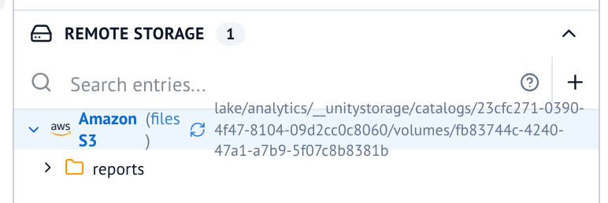

:::tldr
- UC Volumes provide a powerful abstraction for governing and processing unstructured data.
- A volume opens as an obstore store in a marimo notebook, with credentials Unity Catalog vends for that one volume.
- Volumes are a fundamental building block for rich user experiences and storage-based services.
- Much of an agent's context, such as instruction files and LLM wikis, is files by convention, and a volume gives those files a governed home.
:::

The usage of object stores as the storage layer particularly for composable data systems
has been on a continuous rise for several years. For analytical workloads, separated
storage and compute - a key concept of the Lakehouse Architecture - is the de-facto
standard, and even some transactional workloads are following suit.

And while we as a community made great strides managing and governing tabular assets
in object storage via catalogs in recent years, we always kept an escape hatch around.
This escape hatch is plain storage; data pipelines read configuration files, data scientists
develop ideas as scratch files in some personal storage location, and many more examples
where folks need to quickly park something for later use or reference.

Those of you building or using data platforms frequently, will already anticipate the issues
arising from such patterns: missing discoverability and fragmented governance. You will also
recognize these as challenges we already encountered and solved for tabular assets,
particularly those based on open table formats.

In the following sections we will explore how UC leverages well-established abstractions
and capabilities to define a Volume securable, and see how Volumes can be leveraged to
govern and process unstructured data.

## A volume in a marimo notebook

Say you want to browse a volume from a notebook. [marimo](https://marimo.io)
lists every [obstore](https://developmentseed.org/obstore/) store a notebook defines in its
[Remote Storage panel](https://docs.marimo.io/guides/working_with_data/remote_storage/), where
you can browse and download files. Give that store a credential provider that asks Unity Catalog
for credentials, and you can open a volume as a store. This is the cell that does it:

```python file=../../content/unitycatalog/how-to/024-marimo-remote-storage/snippets/notebook.py start=start:nb-store end=end:nb-store title="notebook.py"
```

Once the cell runs, the volume shows up under **Remote Storage** in the **Files** panel:



Other cells read through the same store with plain obstore calls. There are no storage keys anywhere
in the notebook. The store knows the volume's name, and Unity Catalog
answers with the volume's storage location and a credential scoped to it.

The governance comes along for free. `for_volume` asks for `READ_VOLUME`, so the store can list
and read, and storage itself rejects writes. Writing from a cell means asking for `WRITE_VOLUME`,
which needs ownership of the volume. obstore renews the credential once less than five
minutes remain, so a long-running notebook keeps working, and since every renewal goes back to
the server, revoking the grant also cuts off a notebook that is already open.

The provider behind `UnityCatalogCredentials` is a small class, and nothing in it is specific
to marimo. Any tool that accepts an obstore store gets the same volume, with the same grants.
[Use volumes as marimo remote storage](../../content/unitycatalog/how-to/024-marimo-remote-storage/index.md)
walks through the whole notebook, and
[Use Unity Catalog credentials with obstore](../../content/unitycatalog/how-to/023-obstore-credentials/index.md)
explains the provider, including how it serves table files and handles S3, Azure, and Google Cloud
credentials.

## What makes a volume

So what is it that we just opened? Let's take a more formal look at what Volumes are and what
metadata we associate with them.

```json file=volume.json
```

The first thing to note is that Volumes are a first class data asset organized within
the catalog/schema hierarchy. As such they are governed and discoverable just like other assets.
In the same vein, you can supply comments to clarify the intended use of a volume.

The most relevant piece of information though is the storage location. This can be any path under
a previously registered external location or automatically created when the location is `MANAGED`
by Unity Catalog. Using the same [credential vending](../../content/unitycatalog/explanation/002-credential-vending/index.md)
mechanics we already employ for tables via the
[temporary credential APIs](../../content/unitycatalog/how-to/022-temporary-credentials/index.md)
and of course the UC Delta API and IRC protocol implementation in UC, we have battle-tested
abstractions to negotiate access to volumes. That is exactly the API the marimo store calls.

## From one notebook to a platform

As we see, using storage credentials, external (or managed) locations, and a path, we have defined
a Volume abstraction. While this already solves a lot of the aforementioned discoverability and
governance issues we identified, it is worthwhile to take a step back and step into the shoes
of someone designing and building an on-prem data platform. What key experiences does this person
want to offer their users?

Going out on a limb here, but likely users expect some sort of notebook environment and maybe
a SQL editor experience to interact with the data stored on the platform. The marimo panel above
is the read side of that story. The other side is that notebooks themselves usually manifest as
some sort of file, be it `.ipynb`, `.json`, or plain `.py` files. In case of a SQL editor, you might
want to persist state not only in the browser, but make it resumable and shareable by storing it
as a `.sql` file. In fact embedding a text editor to display and edit SQL will get you a long way
towards an incredibly rich editing experience.

By introducing system schemas and/or injected configuration into existing tooling, platform
engineers can leverage volumes to build such file-centric experiences with discoverability
and governance built in from the ground up, not as an additional application-specific
layer bolted on after the fact. Injecting a credential provider into a notebook kernel, so every
user's notebook sees the volumes they are granted and nothing else, is one such integration point.

But that is not all.

## Volumes as AI primitive

In today's world no platform story is complete without agents and AI as primary interfaces.
So why are we boring you with plain old storage when there are so many more exciting things
to talk about? Well, if we look under the hood, much of what we hand to an agent is just
instructions (usually markdown files) along with file-based resources and scripts referenced
in these instructions.

Take [AGENTS.md](https://agents.md), a convention for telling coding agents how to work in a
project: a markdown file at a well-known path, pointing at whatever else the agent should read.
Nothing about it requires a git repository. Put the instructions and their references into a
volume, and its owner decides who can read them, with the same `READ_VOLUME` privilege that
already governs their data. An agent then reads its
context through the same vended credentials the notebook above uses. The files an agent
produces, such as reports or generated notebooks, can land in a volume the same way, and the
`WRITE_VOLUME` check applies to the agent just as it does to a person.

Beyond extending the abilities of your agents via such direct integrations, the community at large
is also hard at work to provide a semantic layer on top of the Lakehouse. And while this is an
expansive and evolving field including the recently announced
[metric view](https://unitycatalog.io/blogs/uc-metric-views/) support in Unity Catalog,
by now you might not be surprised to learn that Volumes are again a great primitive to
build part of your semantic layer.

The idea of an [LLM-wiki](https://gist.github.com/karpathy/442a6bf555914893e9891c11519de94f)
quickly gained traction, and got formalized via the [Open Knowledge Format](https://cloud.google.com/blog/products/data-analytics/how-the-open-knowledge-format-can-improve-data-sharing).
By design this is a very lightweight specification, with the only hard requirement to put a
`type` field into the frontmatter of a markdown file.

Again we see that the fundamental building block is ultimately files. The power comes from the
well known UX concept of [progressive disclosure](https://en.wikipedia.org/wiki/Progressive_disclosure),
which just so happens to align nicely with how we want to populate agent context, loading
only the pieces into context that are relevant to the task at hand. Individual pages of such a
wiki along with the relations to other concepts in the knowledge graph can effectively be shared
using the OpenSharing protocol, particularly [pages](https://github.com/OpenSharing-IO/OpenSharing/blob/main/spec/protocols/GLOSSARY.md).

## Wrapping Up

Every now and then we come across concepts that seem obvious in retrospect
and are simple yet incredibly powerful upon closer examination. To me,
volumes are just that, a governed, secured, and discoverable storage location
that provides significant value on its own, and serves as a key building
block for a wide range of use cases across AI, agents, and platform engineering.

If you want to try it yourself, these pages from the Unity Catalog docs get you there:

- [Manage volumes](../../content/unitycatalog/how-to/006-manage-volumes/index.md) to create a
  volume and see which privileges reading it takes.
- [Working with volumes and files](../../content/unitycatalog/tutorials/006-read-volume-files/index.md)
  to register a folder of documents as a volume and read it knowing only its name.
- [Use volumes as marimo remote storage](../../content/unitycatalog/how-to/024-marimo-remote-storage/index.md)
  for the notebook from this post.
- [Use Unity Catalog credentials with obstore](../../content/unitycatalog/how-to/023-obstore-credentials/index.md)
  to take the same credential provider into your own tools.

Go build!
