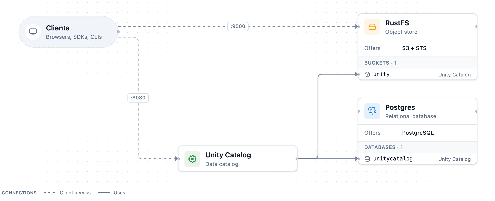
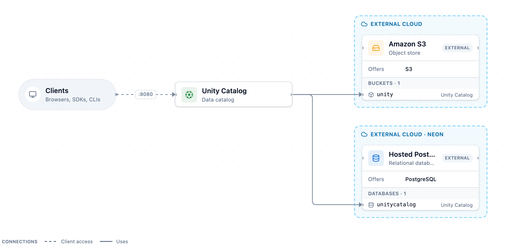
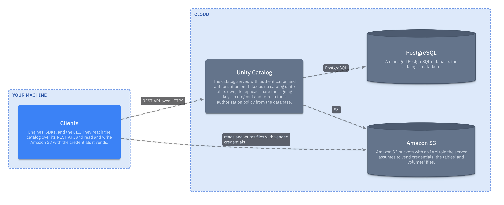

A [Unity Catalog](model:unityCatalogOSS) deployment has three parts: the
server, a [PostgreSQL](model:postgresql) database that holds the catalog's
metadata, and [object storage](model:lakehouse.objectStorage) that holds the
files of its tables and volumes. The server keeps no catalog state of its own:
every catalog, schema, table, and grant is a row in the database, and every
file is in storage. Deploying Unity Catalog therefore comes down to where those
two stores live and where the server runs. Each pattern below moves one more
part off your machine.

| Pattern | Server | Metadata and data | Who shares the catalog |
| --- | --- | --- | --- |
| [Local](#local-everything-on-one-machine) | your machine | your machine's disk | you |
| [Hybrid](#hybrid-a-local-server-with-hosted-state) | each person's machine | a hosted database and bucket | everyone with the database and bucket credentials |
| [Fully hosted](#fully-hosted-only-clients-on-your-machine) | the cloud | the cloud | every client the server authenticates |

The local and hybrid patterns are environments these docs generate with
Trestle. Each diagram below is that environment's plan: select a node's file
count to read the configuration it runs with.

## Local: everything on one machine

The server, PostgreSQL, and RustFS, an S3-compatible object store, run as
containers on one machine under Docker Compose. There is no client-facing
gateway: each service publishes its own port, Unity Catalog's REST API on
`8080` and the S3 API on `9000`, and clients call them directly. An internal
Envoy answers the hostnames of Amazon S3 and AWS Security Token Service (STS)
so that the server's credential vending reaches RustFS. It publishes no port
and isn't on the client path.

The two stores persist differently. PostgreSQL writes the catalog's metadata
into the environment's `.data/postgres` folder, a bind mount, so the catalog
survives `docker compose down`, a new server container, and even
`docker compose down -v`. RustFS keeps the files in the `rustfs-data` Docker
volume, which `down -v` deletes. On start, the stack registers the bucket with
the server as a storage credential and an external location, so the server can
vend credentials for it like it would for Amazon S3 (see
[Credential vending](../credential-vending/index.md)).

:::warning
`docker compose down -v` deletes the files of every table and volume, but the
catalog in `.data/postgres` keeps the entries that point at them. To start
over, follow
[Stop or reset the server](../../how-to/run-local-server/index.md#stop-or-reset-the-server).
:::

The server runs with authorization disabled: whoever can reach port `8080`
acts as the administrator. The ports aren't bound to the loopback address, so
other machines on your network can reach them too. That makes it a
single-user development setup. It depends on one machine, it doesn't isolate
anyone who connects, and the stack starts with one command.

Choose it for development, for learning, and for tests that need a fresh
catalog each run. It stops fitting when a second person needs the same catalog
with their own access, or when the catalog has to outlive your machine.

## Hybrid: a local server with hosted state

The hybrid pattern moves the two stores to hosted services and keeps the
server on your machine. Compared with the local pattern, only the stores
change: [PostgreSQL](model:postgresql) becomes a Neon project, and RustFS
becomes a bucket on an S3-compatible service such as Cloudflare R2 or Tigris.
Unity Catalog still runs in a container on `8080`.

Because the catalog lives in the database, this is already a shared
deployment. Each person runs the same environment with the same database and
bucket credentials, and every server reads and writes the same catalog. A
catalog one server creates is listed by the others, and both servers still
list it after a restart. This page's script, `shared_database.py`, checks that
with two servers on the local pattern's database. The full hybrid run against
a Neon project and an R2 bucket isn't verified here: only the environment's
rendered plan is checked.

The stores have to exist before the stack starts, so the hybrid environment
takes more than `docker compose up`: you create the bucket and the database,
save their secrets, and render the stack again. The
[environment's archive](/env/uc-hybrid.tar.gz) holds those steps in its
`README.md`.

The pattern's limits come from the same fact that makes it work. Every
participant holds the database password and the bucket key:

- **There is no access control between participants.** Each server runs with
  authorization disabled, and anyone with the database password can change
  the catalog directly. Share the credentials only with people you would make
  administrators.
- **Clients bring their own storage keys.** The server vends credentials only
  for Amazon S3 with an IAM role it can assume. An S3-compatible bucket has
  none, so the environment doesn't register it, and engines read and write
  it with the key in `secrets.env`. Clients that rely on vended credentials
  don't work, and neither does managed storage: credential requests for those
  objects fail with `FAILED_PRECONDITION` (see
  [Known issues](../../reference/features-and-limitations/index.md#server)).
- **Every machine holds the secrets.** Each participant's `secrets.env` holds
  the database host, user, and password and the bucket's endpoint and key.

Choose it for a small team that trusts each other: a shared sandbox, a
workshop, or a demo that has to survive a laptop restart.

## Fully hosted: only clients on your machine

The last step moves the server too. Unity Catalog runs in the cloud, next to
a managed PostgreSQL database and the object storage. Your machine runs only
clients: engines, SDKs, and the CLI, which reach the catalog over HTTPS.

What changes is where the secrets live. The database password and the
storage identity stay in the cloud with the server, and clients hold only
their own token and the short-lived credentials the server vends. Vending
needs storage the server can vend for: Amazon S3 with an IAM role it assumes.
[Storage and credentials](../../reference/features-and-limitations/index.md#storage-and-credentials)
lists what other stores support.
Moving the hybrid pattern's server into the cloud doesn't by itself take the
bucket keys off clients: an S3-compatible bucket still has no role to vend
for.

With clients on the other side of a network, the catalog sits at the trust
boundary that [Credential vending](../credential-vending/index.md)
describes, so the server has to turn on authentication and authorization
before anyone else reaches it: see
[Ownership and privileges](../uc-basics/index.md#ownership-and-privileges),
the bootstrap administrator in
[Principals and users](../uc-basics/index.md#principals-and-users), and the
`server.allowed-issuers` and `server.audiences` settings in
[Identity and access](../../reference/features-and-limitations/index.md#identity-and-access).

The server still keeps no catalog state of its own, but it does keep files
that every replica needs. On start it creates its token-signing keys
(`public_key.der`, `private_key.der`, `key_id.txt`) in `etc/conf` unless they
exist
([`SecurityConfiguration.java`](https://github.com/unitycatalog/unitycatalog/blob/v0.7.0/server/src/main/java/io/unitycatalog/server/security/SecurityConfiguration.java)),
and writes `certs.json` and the service token `token.txt` there
([`SecurityContext.java`](https://github.com/unitycatalog/unitycatalog/blob/v0.7.0/server/src/main/java/io/unitycatalog/server/security/SecurityContext.java)).
Persist that folder and share it across replicas, so that every replica
signs and checks tokens with the same keys. Each replica also holds its authorization policy in
memory and doesn't reload grants made on another replica unless
`server.authorization.policy-refresh=true` is set
([Multiple server instances](https://github.com/unitycatalog/unitycatalog/blob/v0.7.0/docs/server/auth.md#multiple-server-instances)).

No environment in these docs renders this pattern. The diagram comes from the
architecture model instead. The database half is the same as in the hybrid
pattern: [Configure PostgreSQL as the metadata database](../../how-to/configure-backend-db/index.md)
points a server at PostgreSQL, and
[Configure AWS storage credentials and external locations](../../how-to/configure-aws-storage/index.md)
sets up vending on S3.

Choose it when the catalog serves people or jobs you don't sit next to:
production pipelines, a shared platform, or anyone who shouldn't hold the
storage keys.

## Next steps

- [Run a local Unity Catalog server](../../how-to/run-local-server/index.md)
- [Configure PostgreSQL as the metadata database](../../how-to/configure-backend-db/index.md)
- [Configure AWS storage credentials and external locations](../../how-to/configure-aws-storage/index.md)
