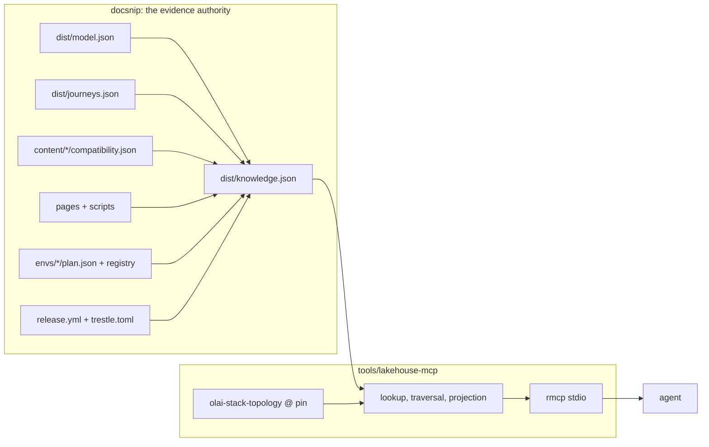

# Lakehouse MCP: the model, journeys, and Trestle as agent tools

**Status:** proposal (2026-10). Nothing here is built.
**Supersedes:** [`agentic-docs.md`](./agentic-docs.md) Phase 4 (hosted MCP
Function with a WASM topology tool).
**Scope:** a new Rust crate (`tools/lakehouse-mcp`), a knowledge bundle written
by `tools/docsnip`, and library changes in Trestle's `olai-stack-topology`.

The repo already knows a lot about the open lakehouse: what each component is,
which specifications it implements, which journeys each engine can run (with a
CI script as proof), which release that's true for, and which tested example
shows it. Trestle knows how to turn a list of capabilities into a running
stack. Today an agent reaches the first half through `docsnip query`, a CLI that
needs this checkout, and the second half through `trestle env new`, which
writes files. This document designs one MCP server that serves both as tools.

It builds on [`trestle-integration.md`](./trestle-integration.md) (§9 defines
`docsnip query`, the server's precursor), [`journey-graph.md`](./journey-graph.md)
(the journey catalog), and [`model-leverage.md`](./model-leverage.md) §3.4
(internal agents first).

## 1. Scope decisions

| Question | Decision | Why |
|---|---|---|
| Who it serves first | Our own agents: `docs-write`, `docs-review`, the blog-review facets, `update-architecture`, `release-bump`, and agents in sibling repos | They need grounding more than any public agent does, and their answers are checkable. `trestle-integration.md` §11 already gates a public MCP on internal accuracy. |
| What it answers about | Only what the model and the journeys cover. Anything else answers `not-modeled`. | The model has 36 implementations and no Trino, Polaris, Flink, or Kafka. Pretending to compare beyond that would make every answer suspect. Coverage grows through model work. |
| What it does | Generates. It returns plans, files, and commands; it starts nothing. | Pure tools are cacheable, safe to host later, and leave execution to the caller's own shell, which already has Docker and permissions. |
| How it ships | A local stdio server first; a hosted transport later from the same core. | Running a stack needs Docker on the user's machine anyway, and stdio needs no auth or infrastructure. |
| In what language | Rust, linking Trestle's planner as a library, over a bundle that Python writes | It matches Trestle and the seed helper, plans in-process, and keeps the evidence logic in the one place it lives today (§6). |

Two framings shaped the tool set.

**"Produce an architecture" is two different answers.** An architect asking
"which catalog and engines give me governance and Iceberg REST?" wants a
*logical* design: capabilities and concerns, the implementations that realize
them, what is compatible, and where the gaps are. That comes from the model and
the journeys. A learner asking for "a lakehouse I can run" wants a *runnable*
stack. That comes from Trestle, which plans 17 modules for one target
(`compose`) and has no query engines; engines are the clients the journeys
test. The server keeps the two apart and links them: a logical answer names the
part of it Trestle can run today.

**The evidence is what an LLM can't produce on its own.** Any model can explain
what a lakehouse is. None can say that DuckDB appends to a Unity Catalog
managed table but can't update its rows on this release, and link the scripts
CI runs to prove both. Every answer carries its evidence state, the release it
holds for, and its citations, or it says `unknown`.

## 2. Users and jobs

| Job | Asks | Tools (§4) |
|---|---|---|
| `docs-write` builds a context pack | What is X, what tests show it, which journeys it passes, on which release | `explain`, `examples_for`, `can`, `compare` |
| `docs-review` / blog review checks a claim | "Does Spark support time travel on UC managed tables?" | `resolve`, `can` |
| `update-architecture` / `release-bump` sizes a change | What a module, element, or pin reaches | `impact` |
| An agent in a sibling repo (Trestle, tributary) | Is my module mapped, what does it realize, what environment runs it | `explain`, `explain_selection`, `list_modules` — without a docs-factory checkout |
| Later: a platform architect | Which components meet these capabilities and concerns, and what is unproven | `candidates`, `compare`, `path` |
| Later: a learner | Give me a stack with catalog, lineage, and notebooks, and something to run on it | `plan_stack`, `examples_for`, `get_page` |

The sibling-repo row is the job the CLI can't do today, and it is the first
reason to build a server rather than more `docsnip query` verbs. The public
rows set the bar for promotion (§8).

## 3. Principles

1. **Every answer carries evidence.** Items carry the states `docsnip query`
   already defines (`configured`, `documented`, `tested`, else `unknown`), the
   release pins they depend on, and citations to pages and scripts.
2. **The bounds are explicit.** A name that resolves to nothing answers
   `not-modeled`, never a best guess. An untested cell answers `unknown`, never
   "probably".
3. **Answers are deterministic.** The same bundle and the same arguments give
   the same answer. Nothing calls the network or a model.
4. **Generate, don't act.** No tool writes files, starts containers, or calls
   the review API.
5. **Two projections, one bundle.** *Internal* includes drafts, `private`
   pages, and non-public elements, as `docsnip query` does. *Public* keeps
   `#public` elements and `ready` pages only, the gate the emitted sites
   already apply. A flag picks the projection at start-up.
6. **Review feedback stays separate.** The review-feedback MCP
   ([`agent-feedback.md`](./agent-feedback.md)) talks to the review API with a
   token. This server reads committed facts. They don't merge.

## 4. Tools

### 4.1 What there is to serve

| Artifact | What it holds |
|---|---|
| `architecture/dist/model.json` | 81 elements (36 implementations, 14 specifications, 12 capabilities, 10 asset kinds, 6 concerns), 203 typed relations, 20 views |
| `architecture/dist/journeys.json` | 207 journeys; 6 access paths, each with the implementations the model lets play each role; obligations for 3 specs; 5 server facts; 16 equivalences |
| `content/<project>/compatibility.json` | Per project, the journey × interface cells and the scripts that prove them |
| `architecture/dist/trestle-catalog.json`, `trestle-context.json` | Trestle's 17 modules and knobs at the pinned revision; 15 roles, 11 mapped to a model concept with `full` or `partial` scope and 4 to infrastructure |
| `envs/<name>/plan.json`, `envs/environments.yml`, `envs/environments.generated.json` | The 5 generated environments: what each runs and how to start it |
| `content/<project>/release.yml` | The release pins |
| Page frontmatter, script metadata, `.md` twins | What explains, references, and demonstrates each element |
| `architecture/glossary.md`, `architecture/journeys/aliases.yml`, model aliases | Names and old ids |

### 4.2 The tool surface

Tools are shaped around tasks, plus two graph primitives as an escape hatch.
Agents do badly writing a graph query language against a schema they don't
know, and a dozen named tools is a surface an agent can choose from.

| Tool | Takes | Returns | Backed by |
|---|---|---|---|
| `resolve` | a name or phrase | the canonical id and kind, or `not-modeled` with the nearest ids | model aliases, glossary, journey aliases (new) |
| `explain` | an element id | what it is, its edges, the pages explaining it | `docsnip query explain` (exists) |
| `neighbors` | an id, optional relation kinds, depth | typed edges out and in | model relations (new) |
| `path` | two ids | the shortest typed paths between them | model relations (new) |
| `can` | an implementation or interface, a journey or task, optional project | one cell: works, fails, or unknown, with the proving script and release | compatibility cells (new) |
| `compare` | ids, and an axis: journeys, capabilities, or concerns | a matrix slice with evidence per cell | compatibility cells, model (new) |
| `candidates` | required capabilities, concerns, or specs; journeys that must work | per role, the implementations that qualify, with evidence, and what is unmet | journeys `paths[].candidates`, `realizes` / `implements` edges, cells (new) |
| `examples_for` | an element or journey | tested scripts and pages that show it | `docsnip query examples-for` (exists, extended to journeys) |
| `environment_for` | a script or `<project>/<journey>` | the environment and how to start it | `docsnip query environment-for` (exists) |
| `explain_selection` | an environment | what it runs and which capabilities and concerns it fully meets | `docsnip query explain-selection` (exists) |
| `impact` | an element, `module:<id>`, or `pin:<…>` | what a change reaches | `docsnip query impact` (exists) |
| `list_modules` | — | Trestle's modules, roles, knobs, and the model concept each realizes | the linked catalog, joined with `trestle-context.json` |
| `plan_stack` | capabilities, optional modules and knob overrides | the plan (graph, services, files, start commands) and which capabilities and concerns it meets, `full` or `partial`; the nearest committed environment when one matches | `olai-stack-topology` in-process (§5) |
| `get_page` | a route or page path | the page's `.md` twin | twins |

Resources: each model view as Mermaid (the output `likec4 gen mermaid` already
gives the twins), and the glossary. One prompt, `design-a-lakehouse`, chains
`candidates` → `plan_stack` → `examples_for`, so a caller sees the logical and
the runnable answer side by side.

`candidates` is the tool the rest exist to support, and the one most likely to
over-claim. It filters and never ranks: it returns what qualifies and what is
missing, with the evidence, and leaves the choice to the caller. Ranking would
need a notion of "better" that the repo can't prove.

### 4.3 Answer envelope

The server keeps the `docsnip-query` envelope (`format`, `version`, `query`,
`id`, `answer`) and raises it to version 2 with three fields on every answer:

- `scope`: `modeled`, or `not-modeled` for a name nothing resolves to;
- `release`: the pins the answer depends on, e.g. `unitycatalog/release`;
- `citations`: page routes and script paths, public routes in the public
  projection.

The envelope is a contract once a server and sibling repos read it, so a
breaking change bumps `version`, and the golden tasks (§7) pin it.

## 5. Plans from Trestle

`plan_stack` and `list_modules` link `olai-stack-topology` and call it
directly. The entry point already exists: `projection::plan_result(&Selection,
target)` plans against `baseline_catalog()` and returns a `PlanResultDto` with
the graph and files, credential-bearing files left out. It is pure, and the
WASM bindings wrap the same function. `plan_result_for_manifest` does the same
for a saved `env.toml`, which is how `plan_stack` reproduces a committed
environment.

The answer joins the plan to the model through the bundle: each planned module
maps to its `model:` concept, each role to its scope from `trestle-context.json`.
That join is what lets `plan_stack` say "this stack has a catalog and lineage,
and meets authorization only partially", rather than returning bare Compose
YAML.

What the planner gives today, and what the server needs:

| Today | Needed | Why |
|---|---|---|
| Plan errors are display strings (`UnsatisfiedDemand`, `Conflict`, `AmbiguousProvider`, `UnsupportedOnTarget`, …) | Serializable errors with a code, the subject, and alternatives | An agent can repair "no provider for `object_store`; candidates `rustfs`, `aws-s3`" but only guess at a sentence |
| Transitive pull-ins are resolved silently | Provenance per node: requested, required by X, or default provider for role R | "Why is Postgres in my stack?" is the first question a learner asks |
| `plan_result` takes `PlanCtx::default()` beyond the target | A partial `PlanCtx` from the caller (ports, provider preferences), which its doc comment already anticipates, and a stable `PlanResultDto` across revisions | A downstream crate pins a revision and must not break on internal moves |
| One target, no engine modules | Later: engine modules (Spark Connect first) and more targets (kind) | Until then a generated stack has a catalog and storage but nothing that queries them, and the answer says so |

The first three are Trestle changes this design depends on. The fourth widens
what `plan_stack` can say, and the server reports its absence rather than
waiting for it.

**One pin.** The crate depends on `olai-stack-topology` by git at the revision
in `envs/trestle.toml`, so the planner the server links is the one that rendered
the committed environments and the catalog snapshot. Moving the pin moves both
in one change (`just trestle-catalog` and `docsnip trestle --pin` own it), and a
test fails when the linked `baseline_catalog()` differs from
`architecture/dist/trestle-catalog.json`.

## 6. Architecture

### 6.1 The knowledge bundle (Python writes it)

The evidence rules are not trivial. `tested` needs a working proof on a ready
page while the compatibility artifacts are current; a `#partial` edge or a
`scope: partial` role never satisfies a target; a parent concern holds only when
every facet is full. They live in `tools/docsnip/src/docsnip/query.py`, on top
of the frontmatter, PEP 723, and compat parsing in `frontmatter.py`,
`scriptmeta.py`, and `compat.py`. Porting all of that to start a server would
create a second implementation to keep in step.

So docsnip writes one bundle, `architecture/dist/knowledge.json`, from the same
`query.load` index, and Rust only reads it:

- elements with kind, summary, tags, aliases, and the public flag;
- relations with kind and `#partial`;
- pages with status, `explains`, cited ids, and twin route;
- scripts with their page, environment, and proofs;
- journeys with their cells, per project, and the paths' role candidates;
- environments with their plans' modules and the capabilities and concerns
  they meet;
- the Trestle role map and catalog snapshot;
- the release pins;
- evidence states, precomputed per element and per script.

Like `compatibility.json` and `journeys.json`, it is committed, carries a
`format`/`version`, and `docsnip check` fails when it's stale. A stale bundle
can't be committed, so the bundle never needs the query-time `compat: stale`
marker that `docsnip query` emits.

Whether `docsnip query` reads the bundle too is open (§10). Reading it would
make the CLI a second consumer and shrink `query.py` to the bundle writer.

### 6.2 The server (Rust)

A new member of the repo's Cargo workspace, `tools/lakehouse-mcp`, with a
library (bundle types, projection, traversal, tool handlers) and a binary
(`lakehouse-mcp --bundle <path> [--public]`).

- **MCP:** the official Rust SDK, `rmcp`, over stdio.
- **Trestle:** `olai-stack-topology` by git at the pin (§5). It sets edition
  2024 and MSRV 1.88, Trestle's, in its own manifest; the workspace default
  stays 2021 for the seed helper and snippets crate.
- **No evidence logic.** The crate looks things up, walks edges, filters by
  projection, and calls the planner. If a tool needs a fact the bundle lacks,
  the bundle grows; Rust doesn't derive it.
- **Wiring:** a `just mcp` recipe builds the binary, and `.mcp.json` registers
  it beside review-feedback through a launcher script, so agents in this
  checkout get it with no setup.
- **Sibling repos** run the binary with `--bundle` pointing at a bundle they
  fetched; they need no docs-factory checkout and no Python. How they fetch it
  is open (§10).

### 6.3 Why not the alternatives

- **A `trestle mcp` subcommand.** One binary for users, but Trestle would have
  to understand this repo's model, journey, and evidence schemas. Today it
  knows only `model:` refs, which keeps it model-agnostic, and that boundary is
  worth keeping. A docs-factory crate that depends on Trestle keeps it.
- **A Python server over `docsnip query`.** The least new code, but planning
  would shell out to a pinned binary with a dry-run mode Trestle doesn't have,
  and sibling-repo agents would need the whole uv workspace.
- **A hosted Function first** (the superseded Phase 4). It needs auth, a
  corpus fetch, and a deploy lifecycle before the answers have been proven on
  internal agents.

### 6.4 Moving docsnip to Rust later

The bundle is the contract, so docsnip's parsing can move to Rust piece by
piece without changing the server: frontmatter, PEP 723 blocks, region markers,
then the compat derivation, each where a suitable crate exists. At that point
the bundle writer can become part of the Rust crate. The golden tasks on both
sides (§7) catch drift while a piece is in flight. None of this is v1.

## 7. Testing

- **Golden tasks.** A Rust test runs a fixed task set against the committed
  bundle and pins exact ids, as `tools/docsnip/tests/test_query_tasks.py` does
  for the CLI. The existing verbs reuse the CLI's tasks, so both sides answer
  them identically. When content moves an answer, the test is updated by hand.
- **Bounds.** Tasks for names outside the model (`trino`, `polaris`) pin
  `not-modeled`, and tasks for untested cells pin `unknown`.
- **Projection.** The same tasks under `--public` pin that no draft page, no
  `private` page, and no non-public element appears.
- **Planner.** `plan_stack` for each committed environment's selection
  reproduces its `plan.json` graph, and the catalog test in §5 guards the pin.

## 8. Promotion to public

The internal server earns trust through use: agents in `docs-write`,
`docs-review`, and the blog review call it, and wrong answers become golden
tasks. The bar for a public projection is the prompt set in
[`prompt-tracking.md`](./prompt-tracking.md). Every prompt the model covers
must get an answer with correct evidence and citations to `ready` pages, and
every prompt it doesn't (Polaris, Gravitino, Glue) must get `not-modeled`
rather than an opinion.

Going public then means a Streamable HTTP transport on the same crate, started
with `--public`. Where it runs (beside the emitted sites, a Function, or as the
library compiled to wasm32, which `olai-stack-topology` already supports)
is decided then.

## 9. Work

| Where | Change |
|---|---|
| docsnip | The bundle writer and its staleness check in `docsnip check`; envelope v2; the pin-coupling check |
| new crate | `tools/lakehouse-mcp`: bundle types, the tools in §4.2, `rmcp` stdio, the golden tasks |
| repo wiring | `just mcp`, the `.mcp.json` entry, a CI job that builds the crate and runs its tests |
| Trestle | Serializable plan errors, node provenance, a caller-supplied `PlanCtx` and a stable `PlanResultDto` (§5) |
| Model | Nothing for v1 |

The existing verbs and `list_modules` can ship before the Trestle changes;
`plan_stack` ships with string errors first if it has to, and says so in its
answer.

## 10. Non-goals and open questions

Not in scope: starting or stopping environments, running scripts, any write
tool, comparisons beyond the modeled estate, and merging with the
review-feedback MCP.

Open:

- **Bundle distribution** for callers without a checkout: a GitHub release
  asset per main commit, or a file on the emitted sites.
- **Bundle size.** The two compatibility artifacts are about 770 KB together;
  if the bundle gets unwieldy, split it per project.
- **`docsnip query` as a consumer** of the bundle (§6.1).
- **Envelope versioning:** whether a minor version is allowed for additive
  fields.
- **Free-text `resolve`:** how far fuzzy matching goes before it starts
  guessing.
