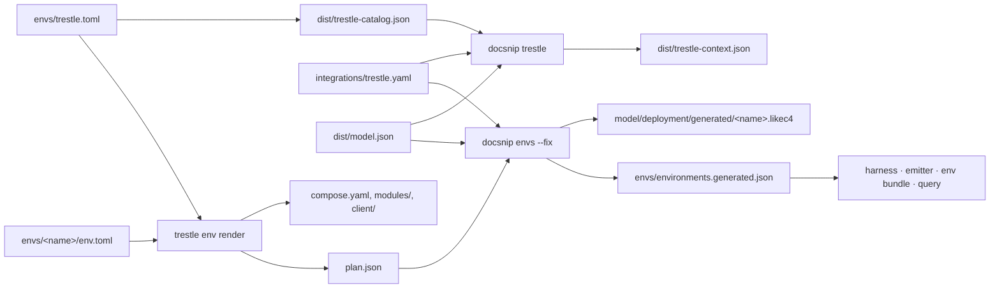

# Trestle integration: generated environments joined to the estate model

**Status:** built (2026-10). Decision record:
[ADR-0003](../decisions/ADR-0003-trestle-generated-environments.md).

The LikeC4 estate model (`architecture/model`), Trestle's environment generator
(`trestle/crates/stack-topology`), the docs environments (`envs/`), and the
tracked journeys (`content/<project>/compatibility.yml`) share one vocabulary:

- Trestle generates every docs environment, and each one appears in the
  model's deployment layer.
- Journeys name the asset they act on and the contracts their participants
  need, so model edges carry CI evidence.
- The joined graph reaches readers and agents as static, grounded context:
  environment service lists, JSON-LD, `concepts.json`, and `docsnip query`.

It builds on [ADR-0001](../decisions/ADR-0001-model-driven-information-system.md),
[`model-leverage.md`](./model-leverage.md), and architecture ADRs
[0003](../../architecture/adr/ADR-0003-logical-abstract-deployment-concrete.md)
through [0007](../../architecture/adr/ADR-0007-cross-cutting-concerns.md).

## 1. Data flow



| Artifact | Written by | Read by |
|---|---|---|
| `envs/trestle.toml` | hand (`git`, `rev`, `package`) | `just trestle-install`, `docsnip trestle --pin`, CI |
| `architecture/dist/trestle-catalog.json` | `just trestle-catalog` (`trestle env list-modules --json`) | `docsnip trestle`, `docsnip query` |
| `architecture/integrations/trestle.yaml` | hand | `docsnip trestle`, `envgen`, `query` |
| `architecture/dist/trestle-context.json` | `docsnip trestle --fix` | the docs emitter (`refs.json`), the review app's diagrams |
| `envs/<name>/env.toml` + `image/` | hand | `trestle env render` |
| `envs/<name>/{compose.yaml,modules/,client/,LAYOUT.md,.env,plan.json}` | `just env-render <name>` | Compose, `docsnip envs`, the harness |
| `architecture/model/deployment/generated/<name>.likec4` | `docsnip envs --fix` | LikeC4 (everything under `model/` loads) |
| `envs/environments.generated.json` | `docsnip envs --fix` | `environments.py`, `registry.mjs` |
| `envs/<name>/diagram.trestle-graph.json` | `docsnip envs --fix` (the plan's `graph`) | `trestle=` embeds, the renderer |
| `envs/<name>/diagram.png` | `just trestle-diagrams` (Chromium) | GitHub, `.md` twins, the sites' no-JS fallback |

Only the Trestle CI workflow builds Trestle. Everything else (the content job,
the bare Vercel build, the reader bundle) reads committed files and needs no
cargo, so nothing in emission can call Trestle.

## 2. Concepts

| Axis | Kind | Members | Realized by |
|---|---|---|---|
| Subject: what the platform manages | `asset` (type-level) | namespace, table, sqlView, metricView, volume, registeredFunction, mlModel, agentSkill, credential, externalLocation | — |
| Function: layers that materialize assets | `capability`, with `openSpecification` contracts | catalog, queryEngine, orchestration, tableFormat, fileFormat, objectStorage, credentialIssuer, modelTracking, sharing, interactiveDevelopment | `implementation` (`implements` a spec or `realizes` the capability) |
| Property: spans assets and capabilities | `concern` ([ADR-0007](../../architecture/adr/ADR-0007-cross-cutting-concerns.md)) | governance (facets authentication, authorization, fineGrainedAccess), lineage, observability | `implementation` (`realizes`) |
| Instance | deployment `environment` / `service` / `datastore` | one generated environment per docs environment, plus the narrative `trustedCompute` | `instanceOf` an implementation |

A concern spans what it applies to through a single dotted edge kind,
`appliesTo`, with the verb in the title ("tracks lineage of", "secures"). A
`realizes` edge carries `#partial` when the implementation meets the target only
together with another contributor (a policy engine decides; something else
enforces). Whether a facet is fully met is a property of an environment's
deployed instances, not of one edge.

**Journeys sit across the triad.** A journey is an outcome a reader seeks on an
asset, with participants that must provide or consume contracts. An interface
(Spark, PyIceberg, the UC CLI) attempts it inside an environment, and a gating
CI claim makes that attempt a verified fact for that scope.

**Trestle's terms map onto the model:**

| Trestle | Model |
|---|---|
| module | implementation (a module names the one it packages) |
| role | contribution to a capability or concern, `full` or `partial` |
| plan | deployment environment |
| provisioned resource (database, bucket) | `datastore` node; not an asset kind |

Trestle's own word "capability" (`Selection.capabilities`, `provider_of`) means a
role string. Neither side renames.

**Evidence is not architecture.** `unityCatalogOSS implements ucSpec` and
`ucSpec governs agentSkill` don't prove that a given OSS release manages skills.
A model edge or graph path never becomes a green compatibility cell;
release-specific support comes from scoped claims, and unknown coverage stays
unknown.

## 3. Ownership and identity

| Fact | Owner |
|---|---|
| Concepts, spec relationships, architectural rationale | the model, `architecture/` |
| Module identities, demands, providers, services, routes, render logic | Trestle's catalog and planner |
| A module's implementation identity | the Trestle module, as its `model:` ref |
| Role → capability/concern contribution, with scope | `architecture/integrations/trestle.yaml` |
| A docs recipe's selections, release pins, local image | `envs/<name>/env.toml` and its `image/` |
| Implementation → asset-kind breadth (`operatesOn`) | the model, `architecture/` |
| Journey identity, asset, requirements | `compatibility.yml` |
| Client/journey support | script claims |
| Execution result | the CI run |

The split between module refs and role mappings is the core decision. A
module's implementation is a stable 1:1 fact that should travel with the module,
including into custom catalogs, so Trestle's own graph can say what a node is.
A role's contribution ("`tracing` is a *partial* contribution to observability")
interprets our concepts, so it lives with them; Trestle never carries it.

Model IDs (`unityCatalogOSS`, `lakehouse.catalog`) are the stable references;
Trestle keeps its own module and role IDs. A LikeC4 FQN comes from nesting, not
kind, so moving an element between kinds changes no ID.

## 4. Mappings

### Module → implementation

Every module in the pinned catalog carries a `model:` ref that resolves to an
implementation in `logical/technology-catalog.likec4`, where its edges live
(`unityCatalogOSS implements icebergRestSpec`, `rustfs implements s3Api`,
`openPolicyAgent realizes governance.authorization #partial`, …):

| Module | `model:` | Role |
|---|---|---|
| `unity-catalog` | `unityCatalogOSS` | `data_catalog` |
| `rustfs`, `aws-s3`, `azurite`, `azure-storage` | `rustfs`, `amazonS3`, `azurite`, `azureBlobStorage` | `object_store` |
| `postgres`, `hosted-postgres` | `postgresql` | `relational_db` |
| `envoy` | `envoy` | `gateway` |
| `authelia` | `authelia` | `auth` |
| `opa` | `openPolicyAgent` | `policy` |
| `mlflow` | `mlflow` | `experiment_tracking` |
| `headwaters` | `headwaters` | `lineage` |
| `jaeger` | `jaeger` | `tracing` |
| `marimo` | `marimo` | `notebooks` |
| `puppygraph` | `puppygraph` | `graph` |
| `rivers` | `rivers` | `orchestration` |
| `omnigent` | `omnigent` | `agent_platform` |

`provider_of` is a single role per module. First-party software (`headwaters`, `hydrofoil`, `omnigent`) is an
implementation like any other; the abstract reference architecture still names
no technology (the 2026-10-16 amendment to architecture ADR-0003).

### Role → contribution

`architecture/integrations/trestle.yaml` maps each role to a `target` with a
`scope`, or marks it `unmapped: infrastructure` (`gateway`, `relational_db`,
`app_runtime`, `agent_platform`) rather than inventing a capability. It records
the catalog it interprets (`catalog: olai-stack-topology`) and flat role
`aliases` for a Trestle rename; duplicate keys fail, since PyYAML would silently
keep the last one. A `partial` role over a `full` edge is fine (the role is
narrower); a `full` role over only `#partial` edges is reported.

### Asset kinds

Only kinds a tracked journey acts on exist (`sqlView`, since `view` is a LikeC4
keyword; `metricView`, `credential`, `externalLocation`, and the earlier
kinds). Instances stay out of the model (ADR-0005). `share` and `connection`
wait for a journey; agents are `person`s, not assets.

Three edges use the subject axis: an asset `dependsOn` the capabilities that
materialize it; a catalog specification `governs` the kinds its contract
covers; an implementation `operatesOn` the kinds it can act on. `operatesOn`
is architectural breadth, not a successful journey. Compatibility claims
verify it without deriving cells from it.

## 5. Journeys join the model

Journeys stay in `compatibility.yml`, not in LikeC4, and keep the
journeys-only rule (no sub-steps, no atomic-operation inventory). Identity is
`(project, journey ID)`.

```yaml
spec: ucSpec                  # topic context; fallback for a journey with no requires
families:
  iceberg:
    asset: lakehouse.table
    requires:
      client:  { consumes:   [icebergRestSpec] }
      catalog: { implements: [icebergRestSpec] }
journeys:
  iceberg.read:
    family: iceberg
    title: Read an Iceberg table
```

- A journey names its `family:` explicitly (never derived from the ID prefix)
  and inherits its `asset` and `requires`, overriding either. A matrix's
  `defaults:` cover journeys without a family (Delta uses one project default,
  `lakehouse.table`).
- `requires` is keyed by **participant** (`client`, `catalog`, `storage`, …),
  journey roles distinct from Trestle roles. A client lists `consumes`; a
  provider lists `implements` (or `realizes` for a capability or concern).
  Lists are conjunctions. Keying by participant makes the client-side and
  server-side checks explicit.
- Name the spec when one exists, else the capability; name an implementation
  only for an implementation-specific task. Interface constraints (Spark 4.2 for
  metric views) stay on the interface `pin`.

`compatibility.json` (v2) carries the resolved projection. Python's resolver in
`compat.py` is authoritative; JS never re-resolves requirements.

### Checks

Malformed references fail; gaps are reported.

| Check | Where | Treatment |
|---|---|---|
| `asset`/`requires` doesn't resolve, wrong kind, malformed | `compat.py` | fail |
| Journey with no asset or requires after family resolution | `compat.py` | report |
| Edge verification: an interface with a ✓ claim on a journey whose `client` consumes S lacks a `consumes S` edge | `compat.py` | report (a model gap; the evidence stands) |
| Asset verification: an interface with a ✓ claim on asset A lacks `operatesOn A` | `compat.py` | report (a model gap; the evidence stands) |
| A modeled `operatesOn` edge has no ready working journey in the project | `compat.py` | report (modeled, unverified breadth) |
| Environment fit: no instance in the claiming script's environment provides a provider participant's requirement | `envgen.fit` | fail |
| Environment fit with several candidates | `envgen.fit` | report |
| Opposing ready claims in one cell | `compat.py` | error |

A claim that deliberately asserts failure because a requirement is unmet is
valid negative evidence. Local participants (the Delta library, the CLI, an
SDK) need no environment.

### Linking content

The compat renderer does the linking. `<!-- compat:asset:<id> -->` renders
every journey on an asset, on the page that `explains:` it. Row headers link
concepts through `model:` links. A page's proven journeys supply its JSON-LD
`about` (assets) and `mentions` (specs, interfaces); hand-written `references:`
covers the rest. `compatibility.json` records which model edges have CI
evidence (`verifiedEdges`), including both contract and `operatesOn` edges.
`<!-- compat:interfaces -->` renders each interface's model binding, contracts,
modeled asset breadth, and ready journey counts. The review app reads the same
artifact, shows each journey's resolved participants, and reports model gaps
without changing cell outcomes.

## 6. Joining the graphs

### Trestle's exports

- **Catalog** (`trestle env list-modules --json`): a `trestle-catalog` v1
  envelope with `generator.revision`. `docsnip trestle` requires that revision
  to equal the pin, so a stale snapshot can't pass.
- **`plan.json`** (`trestle env render`): written from the same settled plan
  that renders the files, as the plan result minus file bodies in a
  `trestle-plan` v1 envelope. It holds graph nodes with their `model:` refs;
  `containers` (name, component, `service|init|sidecar`) beside `services`; typed
  edges with stable composite keys (`kind:from→to:qualifier`); the gateway's
  listeners and routes; the `client` host and container env; the rendered
  `files` (with `sensitive`); and provenance digests. It records planned
  configuration only: no health, no results, no credentials.

Native CLI and WASM share one projection (`olai_stack_topology::projection`).
`trestle --version` prints `trestle <ver> (<rev>)`, which `just trestle-install`
uses to skip a current install in `.tools/trestle`.

### The join in docsnip

`docsnip trestle` (inside `docsnip check`; `--fix` writes the context artifact)
checks that every module ref resolves to an implementation and every role entry
to a capability or concern, and reports unmapped roles and modules. It also
reports concern gaps: facets roll up into their parent, which is reported only
for a facet nothing realizes, and a leaf realized only `#partial` is listed
(today: fineGrainedAccess, realized only by hydrofoil).

`docsnip envs --fix` (`envgen.py`) reads each `plan.json`, the model export, and
the role map, and writes:

1. **A deployment fragment**, `architecture/model/deployment/generated/<name>.likec4`.
   Nodes are `datastore` for `relational_db`/`object_store` roles and `service`
   otherwise, each `instanceOf` its implementation, with
   `metadata { trestleModule … }`. Edges map from plan edges (`uses` toward a
   spec-bearing capability → `consumes`, other `uses` → `dependsOn`, `route` →
   `flows` titled with listener and prefixes, `authenticates`/`authorizes` →
   `dependsOn`; `access` is dropped), and each carries
   `metadata { trestleEdge "<key>" }`. Everything is tagged `#generated`, which
   the estate views exclude, and each fragment has its own `<name>Deploy` view.
2. **Registry facts**, `envs/environments.generated.json` (v1), per
   environment: `ports` (gateway listener host ports), `client-env` (the plan's
   host client env), `services` (node, element, role, the first gateway route's
   host URL), and `files` (the plan's rendered files plus each `build` context,
   never `env.toml` or `plan.json`).

The join never infers an edge the plan doesn't have: a logical blueprint edge
isn't a runtime call, and gateway forward-auth isn't catalog authorization or
row/column enforcement. `docsnip check` fails on a stale fragment or facts file,
or on a plan node without a `model:` ref.

`trustedCompute` stays hand-written as the narrative reference topology. A
generated environment is a fact about a docs environment, and nothing adds
hypothetical services to it.

## 7. Generated environments

| Folder | Registry key | Modules | Metadata | Storage | Scripts |
|---|---|---|---|---|---|
| `envs/unitycatalog` | `unitycatalog/compose.yaml` | unity-catalog (`embedded_metadata`), envoy | H2 inside the server | local paths under `UC_DOCS_ROOT` | most UC pages |
| `envs/uc-aws` | `uc-aws/compose.yaml` | unity-catalog, rustfs, postgres, envoy | Postgres (named volume) | RustFS S3 on host `:9000` | the S3, credential-vending, Iceberg REST, and Postgres-backend pages |

Both share the compose project `uc-docs` and the container name `unitycatalog`,
so they replace each other and `docker exec unitycatalog bin/uc …` works from
either. Both put UC behind the Envoy gateway on host `:8080` at
`/api/2.1/unity-catalog`, so reader URLs are the familiar ones. The recipe
knobs that make that work, all Trestle UC/RustFS/Postgres knobs:

| Need | Knob |
|---|---|
| The docs image (`gcompat`, `run-as-owner`, `bin/uc`; see `envs/unitycatalog/README.md`) | `image` + `build = "image"` |
| A stable container name | `container_name` |
| `UC_DOCS_ROOT` at the same path in the container, writable on Linux | `extra_mounts`, `writable_mounts` |
| H2 instead of a relational and object store | `embedded_metadata` |
| Pages register their own credential and external location | `storage_bootstrap = "none"`, `master_role_arn` |
| `AWS_ENDPOINT_URL` / `AWS_ALLOW_HTTP` for host clients (opt-in, since a global endpoint also redirects STS) | rustfs `generic_endpoint_env` |
| A metastore `down -v` resets | postgres `data = "volume"` |
| S3 on host `:9000` | `[context] dedicated_listener_ports` |
| UC's `server.properties`, `hibernate.properties`, `.env` as plain files | `[context] local_secrets = "inline"` (throwaway local keys; refuses hosted modules) |

Postgres lives in `uc-aws` rather than in its own environment because Trestle
can't render Postgres without an object store, and the extra environment would
carry the same RustFS anyway.

**Regenerated as a unit.** Each folder commits its recipe, build context,
render, and `plan.json`; change `env.toml`, run `just env-render <name>`, and
never hand-edit a render. `just bump-uc` re-renders every environment, since the
recipes carry the image tag.

**The registry.** `envs/environments.yml` keeps the reader-facing entry per
compose key: `title`, optional `guide`, and `generated: <name>`. A generated
entry may not author `ports`, `client-env`, `services`, or `files`; both readers
(`tools/docsnip/src/docsnip/environments.py`, `site/src/content-core/registry.mjs`)
merge them from `environments.generated.json`, and neither derives anything. An
entry without `generated:` authors its own `ports` and `client-env`. No current
environment uses that path; it stays for a stack Trestle can't express.

**The harness.** `content/conftest.py` takes a generated environment's base URL
from `plan.json`'s host client env (UC is only reachable through the gateway)
and hands the registry's `client-env` to the script, so the variables a reader
exports are the ones the test uses. A hand-written stack falls back to the
service-port lookup.

**The reader bundle.** `/env/uc-docs-env.tar.gz` ships exactly each generated
environment's `files` manifest and fails on an untracked entry, so readers get
what CI runs.

**CI.** `.github/workflows/trestle.yml` (path-filtered and nightly) installs the
pinned Trestle (cached by revision), re-snapshots the catalog, runs
`docsnip trestle`, re-renders every environment with `docsnip envs --fix`, and
fails on any diff. `env-bundle-smoke.yml` builds the reader archive, extracts it
outside the checkout, starts `uc-aws` from it, and runs one page script with
`client/host.env` exported. The page scripts run in the regular CI lanes against
the committed renders.

Not every journey needs Compose: CLI, SDK, function, volume, and Delta-library
examples run without a stack. Delta's Spark lane and the `kind` lane (H22, H24)
aren't Trestle environments.

## 8. Reader surfaces

The `model-leverage.md` §2 verdicts hold: no generated page per element, and
raw `model.json` stays internal.

- **The public selection** is a LikeC4 `#public` tag on each element readers
  may see: what ready pages cite and what docs environments run. A ready page
  citing an untagged element doesn't publish it; `docsnip check` reports the
  citation. `publicProjection` (`site/src/content-core/projection.mjs`) builds
  the per-site projection in JS, because it needs the site's routes, and
  rebuilds every record from allow-listed fields, since the inputs carry
  internal metadata and script paths. A `model:` link to a non-public element
  unwraps to its label.
- **"What's in this environment."** `:::prerequisites` lists the environment's
  public services: a `model:` link, a one-line role, and its URL. The `.md` twin
  carries the same list.
- **JSON-LD** (`docPageHead`, `site/src/content-core/head.mjs`): terms are
  `DefinedTerm`s (`SoftwareApplication` for implementations) with `@id`
  `<origin>/concepts.json#<id>`. A how-to or tutorial that runs an environment
  is `["TechArticle", "HowTo"]`, with `tool` from its public services and
  `dependencies` naming the environment and bundle.
- **`concepts.json`** v1 (`emit/docs/discovery.mjs`): public concepts, edges
  with `partial` and `verified`, environments with their public services, and
  journeys. An edge is `verified` only through a working proof on a ready page of
  that site.
- A `--drafts` preview keeps linking draft explainers, but every public payload
  (service lists, JSON-LD, `concepts.json`), and the review app's Head tab, uses
  the ready-only projection.
- **Environment diagrams.** A page embeds an environment's topology as
  ``, or a snapshot exported
  from Trestle's editor as ``. The snapshot is the
  `trestle-graph` v1 envelope `@open-lakehouse/trestle-diagram` draws; for an
  environment, `docsnip envs --fix` writes it from `plan.json`'s `graph`. The
  PNG beside it is what GitHub, the twins, and no-JS readers see; the preview
  and the sites swap in the interactive canvas (`remark-trestle-views`, which
  fetches the snapshot beside the PNG). `just trestle-diagrams` renders the PNG
  by screenshotting the package in headless Chromium, and stamps it with the
  snapshot's SHA-256 in a `tEXt` chunk. Chromium's bytes aren't stable across
  machines, so `docsnip check` compares that digest, never the bytes, and the
  renderer skips current PNGs. The emitter ships the committed PNG; emission
  needs no Chromium.
- **The context artifact** (`trestle-context.json`) records, per module and
  role, the concept refs, titles, summaries, and links. It carries model facts
  only, no evidence.
- **Diagram nodes link to the model.** A node's name links to its module's
  implementation and its role line ("Data catalog") to the role's capability or
  concern, each with a hover card. Trestle knows nothing of the model: the
  package takes `slots` (a renderer for the name and role lines, given the
  node) and `useDiagramPortal()` (where a host popover goes, outside the
  diagram's style scope), and the snapshot stays as Trestle wrote it. The
  mapping is `nodeConcepts` in content-core (`trestle-refs.mjs`). On a site the
  emitter writes `/assets/trestle/refs.json` from the context artifact, keeping
  only `#public` concepts and linking them through the `model:` link resolver,
  so a role whose concept isn't public stays plain text. A `partial` role says
  so in its card. The review app resolves every element, as its `model:` links
  do.
- **A node counts the asset kinds it manages.** A chip at the end of the node's
  header (the package's `aside` slot) shows how many asset kinds the
  implementation manages, and its hover card lists them. The kinds are what the
  specs it `implements` `governs`, plus what it `operatesOn` directly, in model
  order. `docsnip trestle --fix` writes them to the implementation's `assets` in
  the context artifact, and `nodeAssets` reads them. A site's `refs.json`
  keeps only the public kinds and drops the chip when none remain. The header
  has a fixed height, so the layout and the PNG don't change.

## 9. Agent queries

`docsnip query <verb> <id>` (`tools/docsnip/src/docsnip/query.py`, skill
`.claude/skills/docs-query`) answers over committed files only, with no Trestle,
cargo, or network, in a `docsnip-query` v1 envelope with stable IDs. Its scope is
internal: drafts and non-public elements appear.

| Verb | Takes | Answers |
|---|---|---|
| `explain` | an element | what it is, its edges, the pages explaining it |
| `examples-for` | a concept | tested scripts and pages that show it |
| `environment-for` | a script path or `<project>/<journey>` | the environment and how to regenerate it |
| `explain-selection` | an environment name or registry key | what it runs, and which capabilities and concerns it fully meets |
| `impact` | an element, `module:<id>`, `pin:<project>/<key>`, or `pin:trestle` | the environments, scripts, claims, pages, citing pages, and views a change reaches |

Each item's evidence is the sorted list of states that hold (`configured`: a
plan runs it; `documented`: a ready page explains or links it; `tested`: a
working proof on a ready page), else `["unknown"]`. `tested` is withheld, and the
answer marked `compat: stale`, while `compat --fix` would rewrite a committed
artifact. A `#partial` edge or a `scope: partial` role never satisfies a target,
and a parent concern holds in an environment only when every facet is `full`.
`release-bump` starts its claims review from `impact pin:<project>/release`.

`tools/docsnip/tests/test_query_tasks.py` pins a fixed task set to exact IDs.
When content moves an answer, update the test by hand.

## 10. Operating it

- **Move the Trestle pin.** Set `rev` in `envs/trestle.toml` to a merge commit
  on Trestle's `main` (no release is cut for it), then
  `just trestle-catalog && just env-render`, and commit the snapshot, renders,
  fragments, facts, and diagrams together.
- **Map a new module or role.** The module's `model:` ref is Trestle's; add the
  implementation (and its edges) to the technology catalog if missing, add the
  role to `trestle.yaml` with a scope, then `just trestle-catalog`.
- **Add a generated environment.** Write `envs/<name>/env.toml` (and `image/`
  if it builds one), `just env-render <name>`, add a `generated: <name>` entry
  to `environments.yml`, and point scripts' `[tool.docs-factory] compose` at its
  key. The render's `.env` (inline local secrets) is committed with the rest;
  only `.data/` is ignored.

## 11. Known gaps

- fineGrainedAccess is realized only `#partial` (hydrofoil), and no docs
  environment runs hydrofoil, so no environment fully meets governance.
- The gateway has no `/` route; a bare `localhost:8080` answers 404.
- Environment-fit ambiguity has no `binding:` override yet; none has arisen.
- Opposing claims across recipes are an error; there are no per-recipe views.
- Image digests aren't locked; the docs Dockerfile's `FROM` follows the release
  tag, which `release.yml` moves.
- A public MCP and a `generate_stack(capabilities[])` tool wait until the
  internal queries prove accurate.
- Diagram PNGs are element screenshots of the embed; a headless image export
  in `@open-lakehouse/trestle-diagram` would drop the framing heuristics.
  The blog MDX targets ship a `trestle=` image as a plain static image.
