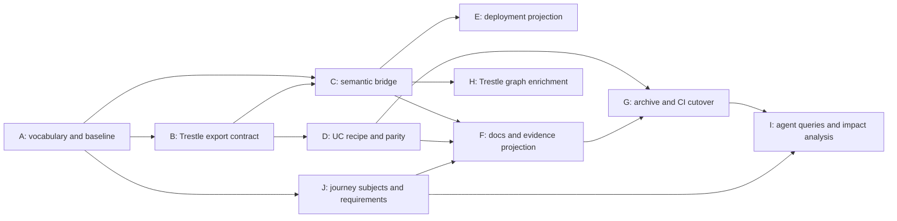

# Trestle and lakehouse model convergence: implementation plan

**Status:** draft execution plan, 2026-10-15. No implementation has been made.
**Design:** [convergence proposal](trestle-model-convergence.md).
**Default pilot:** Unity Catalog docs, beginning with an S3 credential-vending
journey. This choice is a proposal, not a recorded user decision.

Each work package should fit a separate implementation session. Reinspect both
repositories at its start. Paths below are relative to the repository named;
new paths and commands are explicitly proposed. Record the actual resulting
package/artifact versions in the handoff, not an assumed sibling checkout path.

## Sequence and ownership

J's initial metadata and diagnostics can ship without B or a Trestle integration.
The first environment milestone is **B + C + D**: one recipe produces a runnable
pilot, a topology export, and a validated semantic join. The full reader-facing
milestone adds **E + F + G**: the same environment has a C4 deployment view,
published context including J's journey links, and a tested downloadable archive.
H and I can follow without blocking reader downloads. No work package changes
a page to `ready` without the existing review approval signal.

## A. Establish the vocabulary and baseline

**Repository:** docs-factory. **Dependencies:** none.

1. Audit model source, export, prose, and `canonicals.yaml`. Record the actual
   deployment scenarios, missing roles, stale IDs, asset edges, and maturity
   conventions. Reconcile factual drift from source evidence; do not create
   absent systems merely because old prose names them.
2. Clarify the proposed capability/specification/implementation/instance
   distinction in an architecture decision proposal. Explain its effect on
   ADR-0003 and ADR-0004 and on first-party implementations. Preserve current
   element IDs, page references, and view IDs.
3. Define stable concept-reference namespaces and an alias policy, plus explicit
   visibility metadata for a public concept projection. Use a positive public
   selection; do not assume all logical elements are publishable.
4. Audit view and MCP terminology. Add only the asset/specification kinds needed
   by a concrete example, with official source references and qualifications for
   implementation coverage. Keep a skill artifact distinct from its host.
5. Produce a parity inventory of all three current UC environment variants and
   the ready scripts that use them. Include Linux ownership, local CLI behavior,
   mounted paths, release pins, persistent state, endpoints, and test isolation.

**Likely files:** `architecture/{README.md,canonicals.yaml,glossary.md}`, affected
`architecture/design/` and `architecture/adr/` records, `.likec4` sources only
where the audit warrants a factual correction. Align the existing architecture
maintenance skill when its layering guidance changes.

**Acceptance:** a consistent baseline and a reviewed vocabulary proposal;
resolved existing references do not regress. If model source changes, run
`just arch-refresh` and commit its normal generated artifacts with it. Run
`uv run docsnip check` for affected content/bindings. Audit findings can remain
explicit open coverage items; broad estate completion is not a prerequisite.

**Handoff:** source inventory, accepted/proposed distinctions, pilot script list,
and any unresolved semantics that affect B or C.

## B. Export a reproducible Trestle environment contract

**Repository:** trestle. **Dependencies:** A's terminology and inventory.

1. Make the pure topology projection available to native CLI and WASM consumers.
   Prefer a pure `stack-topology::projection` module, re-exporting existing DTO
   names from the WASM crate where needed. Inspect dependency cost before
   settling the module boundary. Do not create a second implementation of
   `graph_dto`.
2. Define a versioned export envelope with a schema and fixtures. Export the
   settled functional graph, service inventory and component membership,
   endpoint/route identities, provider/resource choices, published ports, and
   host/container client contracts. Keep typed edge semantics and external
   placement. Identify the catalog as well as module IDs. Give edges stable
   composite keys; the current DTO does not supply explicit edge IDs.
3. Record normalized recipe, generator/catalog identity, target, and deterministic
   digests of exported/materialized inputs. Canonicalization must exclude
   timestamps and machine-specific output directories; environment-specific
   context that affects the plan remains part of its identity.
4. Export from the actual `Plan` used to materialize files, honoring full
   `EnvManifest.context`. Extend the browser entry point to accept that context
   while retaining the old defaulting call for compatibility. Pin a regression
   case with a nondefault gateway port/provider preference.
5. Add scripted CLI export, proposed as
   `trestle env export <DIR> --format json`. The exact flag spelling can follow
   Trestle CLI conventions; document it in the handoff. File export is a consumer
   of the pure planner and does not start Docker.
6. Keep diagram snapshots readable: preserve v1 graph rendering, or introduce a
   clear snapshot migration/version bump if required. Validate node IDs, edge
   endpoints, duplicate identities, and supported versions beyond the current
   shallow envelope check.

**Likely files:** `crates/stack-topology/src/{lib.rs,manifest.rs,projection.rs}`
(projection is new), `crates/stack-topology-wasm/src/{dto,topology,bindings}.rs`,
`crates/trestle/src/cli/env.rs`, diagram snapshot types and reader in
`node/env-editor/src/diagram/`.

**Acceptance:** identical normalized inputs produce identical exports; custom
context survives export; graph and files agree on providers, ports, and routes;
helpers and hosted providers retain correct membership. Native and WASM paths
use one projection. Unknown versions fail clearly. Graph exports contain no
resolved credentials. A graph export describes planned configuration, not health.

**Validation:** targeted Rust projection/CLI tests, existing topology tests,
WASM build and focused binding checks, diagram snapshot tests/typecheck. Use
fixtures for baseline UC, nondefault context, and a hosted provider. Publish or
attach the export schema and examples as the downstream contract.

## C. Build the semantic bridge once

**Repository:** docs-factory. **Dependencies:** A and B's export fixture/schema.

1. Add one versioned mapping, proposed at
   `architecture/integrations/trestle.yaml`. Key mappings by catalog identity
   and module or role ID. Module mappings identify packaged implementations;
   role mappings identify capability contributions. Represent partial scope
   explicitly. A module may package several implementations.
2. Implement a pure join over a Trestle export, the LikeC4 export, mapping, and
   optional published page bindings. Proposed shared implementation:
   `site/src/content-core/topology.mjs`, with a thin build/CLI driver. Extend
   shared model parsing rather than cloning `emit/docs/model.mjs` ad hoc.
3. Preserve raw Trestle topology fields and service membership. Attach concept
   references, definition provenance, links, and input digests. Leave unmapped
   components visible and report coverage. Do not infer support through
   transitive `implements`/`governs` edges.
   Support scoped endpoint-to-contract mappings for J's concrete participant
   bindings; an implementation's abstract support is insufficient to assert
   that every configured endpoint exposes that contract.
4. Start with UC OSS and the pilot's supporting implementations. Add factual
   technology-catalog entries for RustFS, PostgreSQL, Envoy, or other pilot
   components as needed. Do not target absent governance roles from stale prose.
5. Expose a command to validate explicit mappings and produce a portable context
   artifact. A declared target missing from the model or the pinned catalog is
   an error; an unbound unrelated catalog module is a coverage gap. Support
   aliases and detect conflicting/ambiguous mappings.

**Acceptance:** pilot nodes have stable references to the correct implementation
and capability context; `tracing` maps as a contribution, not complete
observability. `relational_db` can remain supporting infrastructure. Unknown
modules survive the join. The join runs with fixture exports and no sibling
checkout or network access.

**Validation:** focused contract tests for identity, aliases, ambiguous/partial
mappings, missing targets, a multi-service module, and unmapped infrastructure.
If Python needs the joined result, consume the versioned output instead of
reimplementing this join.

**Handoff:** mapping schema, portable context example, coverage report, CLI,
and compatibility policy. This is the artifact H consumes; Trestle must not
hand-maintain a second concept mapping.

## D. Generate a UC pilot and demonstrate environment parity

**Repositories:** trestle for reusable module behavior; docs-factory for recipe,
release inputs, local image adjustments, and generated pilot. **Depends on:** B.

1. Add a separate pilot environment, proposed under `envs/unitycatalog-trestle/`.
   Commit its `env.toml`, generator/catalog pin, complete generated payload,
   topology export, and file manifest. Keep current page references intact
   while evaluating the pilot.
2. Resolve the docs release from `content/unitycatalog/release.yml` and pass it
   explicitly to generation. Include every effective image/config override in
   provenance; do not fall back to Trestle's UC 0.6.0 default.
   Pin runtime images to immutable digests in the recipe or a lock artifact,
   including helper/init images. Record local build inputs and tested image
   digests separately from the recipe's structural digest.
3. Reproduce the current docs image adjustments, build context, shared local
   path behavior, CLI invocation, startup, and teardown. Prefer reusable module
   options or a distinctly named docs module over post-generation YAML patches.
   If a docs module is needed, C maps it to the same UC OSS implementation.
4. Start with S3 credential vending, keeping local authorization scope explicit.
   Compare the emitted UC properties, AWS hostname impersonation, trust files,
   and STS behavior with the existing setup.
5. Assess optional database/object-store configuration for the basic H2/local
   variant and the PostgreSQL variant. Complete their parity before replacing
   those recipes; do not require every tutorial to acquire S3 and PostgreSQL.
6. Create a checked adapter for the docs clients' environment variables and
   base URL. Preserve client-specific requirements such as `AWS_ALLOW_HTTP`.
   Derive endpoints from generated host-vantage values.
7. Define a public-demo materialization policy. The complete runnable payload
   includes locally required config files even if Trestle marks them sensitive
   for permissions. It excludes user/hosted credentials and is not the browser
   DTO's filtered `files` list. Generate from clean pinned inputs so preserved
   operator files cannot affect the published result.

**Acceptance:** at least one existing ready S3 credential-vending script runs
against the generated pilot; Docker-free generation is deterministic; every
Compose/build reference resolves within its intended bundle. No compatibility
claim is weakened to make the pilot pass. Remaining base/PostgreSQL gaps are
recorded explicitly and block cutover of those variants.

**Validation:** targeted Trestle module/render tests, `docker compose config`,
startup and existing pilot journey script, and Linux ownership/CLI checks in
the relevant service CI lane. Reuse colocated runnable snippets as behavioral
tests. No documentation script is copied into a second test implementation.

## E. Project the pilot into a C4 deployment view

**Repository:** docs-factory. **Dependencies:** A, B, C; D's actual pilot when ready.

1. Prototype a generated LikeC4 fragment from the joined pilot export. Use
   environment-qualified IDs with deterministic escaping and a collision map.
   Instantiate known software implementations and retain one-to-many module
   membership. Map runtime relationships explicitly; if the current vocabulary
   lacks a kind, add a documented kind or a faithful labeled generic edge.
2. Validate native implementation instances with LikeC4 1.58.0. Check nested
   helpers, external resources, and relationships against actual deployment
   syntax. Keep provider resources separate from catalog asset kinds.
3. Ensure capability/specification context remains reachable from implementation
   instances. Never copy logical blueprint edges into the environment as runtime
   calls. Do not infer trust or fine-grained enforcement from placement alone.
4. Validate generated fragments in a temporary composite model. Keep generated
   concrete environments separate from authored reference scenarios and avoid
   making every environment part of the default estate diagram.

**Acceptance:** one generated environment validates and displays implementation
identity and runtime edges matching the Trestle export. Every projected edge is
traceable to that export or explicitly labeled semantic context. Existing
authored view IDs continue to work. Record any necessary ADR amendment from A
before adopting the representation broadly.

**Validation:** semantic projection assertions plus `just arch-check` (or the
equivalent validator over the temporary composite). Inspect the pilot diagram.
Do not rely solely on a screenshot comparison.

## F. Join published docs, examples, and environment evidence

**Repository:** docs-factory. **Dependencies:** C, D, and J's first slice.

1. Extend the existing environment registry/reader contract to reference generated
   topology and provenance. Preserve Compose-path keys used by scripts. Titles
   and setup-guide links remain authored; endpoint/port values are derived or
   checked. Update JS/Python loaders with a shared fixture/drift check.
2. Extend `environments.json` additively where safe; bump its version for
   incompatible changes. Link a per-environment topology/context export rather
   than embedding the entire internal estate model in each page.
3. Join each script's existing environment key and compatibility claims to its
   exact recipe/release/client scope. Preserve existing matrix outcomes and
   ready-page gating. A historical pass from another recipe revision is not
   evidence that the current recipe passed. If actual run IDs are exposed,
   source them from CI; do not invent them from frontmatter status.
   Bind J's participant requirements to concrete services/endpoints, retaining
   environment-scoped diagnostics separately from the compatibility outcome.
4. Generate a short environment description and component table for the pilot's
   reader page and Markdown twin. Include implementation identity, access path,
   relevant limitations, and links to the approved explaining/how-to pages.
5. Implement the curated public concept/context projection proposed by
   `model-leverage.md`, scoped to each emitted site's selected corpus. Filter
   nodes, relationships, page bindings, internal paths, and enrichment fields.
   Deliberately public environment diagrams are eligible independently of
   internal reference deployments. Use normal site identity helpers for URLs.
6. Link the resulting static resources from the site's existing discovery
   artifacts. Add structured data only for facts supported by the public
   projection. Keep raw estate exports out of the public bundle.
7. Project journey → asset/contract → approved example links in both directions.
   Derive page/region associations from script claims. Distinguish demonstrated
   subjects and used dependencies from a page's primary explaining concept;
   avoid requiring duplicate authored journey lists on pages.

**Likely files:** `envs/environments.yml`,
`site/src/content-core/{registry,environment}.mjs`,
`tools/docsnip/src/docsnip/{environments,scriptmeta,compat}.py`,
`emit/docs/{model,env-bundle,emit-docs,discovery}.mjs`, relevant plugins/tests.
Consolidate with existing `model-leverage.md` work rather than starting a
competing concept index.

**Acceptance:** a reader or agent can traverse page → script → environment →
implementation → specification/capability → relevant explanation. Existing
matrix outcomes remain evidence-based. HTML and Markdown contain useful static
context. A public artifact cannot expose a private/draft page through an edge,
backlink, generated description, or model metadata.

**Validation:** focused registry/projection/emitter tests, negative visibility
fixtures, JSON version checks, and `uv run docsnip check`. Emit the pilot site's
selected corpus and inspect links, text, and public payloads.

## G. Ship and test the exact downloadable payload

**Repository:** docs-factory. **Dependencies:** D and F.

1. Replace directory-wide bundle selection for generated environments with an
   explicit runtime-file manifest. Include all transitive Compose inputs,
   scripts, build contexts, and required modes. Recipes and graph metadata are
   published only when explicitly selected. Preserve legacy environment bundles
   while migrating their variants.
2. Add a pinned generation/check command, proposed as
   `just env-check <key>`, rendering into a clean temporary directory and comparing
   generated payload, export, and digests with committed artifacts. Generator
   upgrades produce a reviewable diff. Document artifact acquisition so CI does
   not depend on a developer's sibling checkout.
3. Change the test harness's hard-coded
   `get_service_host_and_port("unitycatalog", 8080)` assumption where needed to
   consume the generated host client contract. Preserve per-script isolation,
   service logs on failure, and cleanup. Keep backward compatibility for unmigrated
   legacy recipes until their cutover.
4. Add an archive smoke test: extract the emitted archive outside the repository,
   resolve/start Compose there, run the same pilot script against it, then stop
   and remove its test state. Assert that archived runtime files match the
   payload exercised by CI.
5. Migrate one environment variant at a time, running all affected ready scripts
   before replacing its registry payload. Preserve setup commands/container
   conventions or update all dependent examples in the same migration. Remove
   old inputs only after that variant's parity is established.
6. Add the concrete contributor-convention updates from the design. Update
   release-bump tooling so a UC release changes the recipe, generated environment,
   and compatibility release review together. Rewrite stale `agentic-docs.md`
   assumptions and link the consolidated design from `model-leverage.md`.

**Acceptance:** a clean reader archive runs the gated journeys; no hidden repo
path is needed. Emission needs neither Trestle nor a Rust toolchain. Generation
drift fails CI; a graph cannot silently describe a different bundle. Each variant
has a straightforward rollback to the previous recipe and generated payload.

**Validation:** regeneration check, archive/content assertions, existing affected
snippet lanes, relevant emitter/content-core tests, and normal docsnip validation.
Run broader tests only as required by changed modules. Do not mark pages ready
or deploy/publish packages as an incidental part of integration work.

## H. Enrich Trestle's diagram experience

**Repository:** trestle. **Dependencies:** C's portable context contract; F for
public-site links. This can follow G.

1. Accept optional enrichment keyed by catalog, module, and namespaced concept
   references. Consume an artifact, not a live checkout of docs-factory.
2. Show concept definitions, implementation/specification context, partial
   capability contributions, and relevant docs/examples in an inspector.
   Preserve Trestle's current topology, icons, grouping, and service/resource data.
3. Export frozen enriched snapshots with input digests and semantic provenance.
   Existing unenriched snapshots and offline diagram rendering keep working.
   Handle unsupported schema versions explicitly.
4. Use a portable renderer entry point/build artifact. Current packages are
   private workspace packages, so decide packaging/versioning before another
   repo imports them. A static fallback and links can ship before an interactive
   dependency is distributed.

**Acceptance:** the same pilot module resolves to the same concepts on the docs
site and in Trestle. Missing enrichment leaves a functional graph. A newer
context artifact does not silently rewrite a saved snapshot's semantics.

**Validation:** snapshot compatibility and UI/inspector tests, package typecheck,
and a portable consumption smoke test with no Trestle monorepo workspace.

## I. Add agent queries and maintenance impact analysis

**Repository:** docs-factory first. **Dependencies:** G and J, with H optional.

1. Expose local queries over the same versioned artifacts: environment for an
   example, concepts and wiring of an environment, tested examples for a concept,
   and the reasons/prerequisites behind a Trestle selection.
2. Return evidence scope, stable IDs, exact artifact inputs, and unresolved
   coverage. Keep "configured", "tested in this revision", "documented", and
   "unknown" distinct. Partial capability mappings cannot satisfy a broader
   outcome request automatically.
3. Add changed-module/concept/release impact reports for recipes, claims, pages,
   and diagrams. Route review findings through existing content/review workflows.
4. Evaluate a small fixed set of real tasks: locate a vended-credential example,
   explain its components, regenerate its stack, identify why a full-governance
   request lacks evidence, and list pages affected by a UC pin change.

**Acceptance:** query answers are reproducible from artifacts and link to the
supporting docs/scripts; uncertain requests report gaps. Consider a public MCP
wrapper only after local tasks are accurate. A hosted MCP service, live runtime
discovery, universal ontology, production deployment targets, and automatic
publication of generated pages are separate follow-ups.

## J. Connect journey subjects and requirements to model concepts

**Repository:** docs-factory. **Dependencies:** A for the initial slice; C and D
for concrete generated-environment bindings. Implement the first slice before F.

1. Extend the existing `Journey` schema in `compat.py` and `compatibility.yml`
   with optional `subjects` (asset-kind references) and role-based `requires`.
   Start with `consumes` requirements for clients and `implements` requirements
   for providers, using specification references. Do not introduce a second
   journey registry or manually duplicate journeys as LikeC4 elements.
2. Preserve `(project, journey ID)` identities, `request` tracking, existing
   `claims.<interface>`, region/anchor links, matrix row order, and ready-page
   gating. Leave the review request protocol/DB unchanged: semantic annotations
   can be added when an accepted journey request becomes a git entry.
3. Migrate three representative journeys: UC `iceberg.read`, a UC API catalog
   operation, and Delta `read.scan` through a local library. The first requires
   Iceberg REST rather than assuming the matrix's `ucSpec`; the last needs no
   catalog service or Compose stack. Include an existing CLI/SDK claimant when
   checking that participant logic does not assume all clients are engines.
4. Replace the blanket matrix-spec diagnostic for annotated journeys with
   per-journey participant/contract checks. Retain the matrix `spec` as topic
   context and legacy fallback for unmigrated journeys; do not union it into
   explicit client requirements and falsely require a UC API consumer for an
   Iceberg REST operation. Do not infer semantics by parsing journey ID prefixes.
5. Derive realization context from existing claims, interface model/pin fields,
   script dependencies and declared environment. A package list supplies version
   evidence, not an inferred interface identity. Preserve known connector/library
   composition explicitly where needed; report missing model coverage.
6. Extend `compatibility.json` and its consumers with journey subject/requirement
   metadata, per-proof environment identity, and separate structural diagnostics.
   Follow an explicit artifact compatibility policy when adding fields. Keep
   Python's compatibility resolver authoritative; JS consumes its projection
   rather than reimplementing requirement resolution.
7. Validate declared IDs/kinds and dangling explicit bindings. Report unmigrated
   metadata or absent model edges as coverage gaps. Preserve successful test
   evidence even when its model edge is missing. Negative claims can describe
   failed attempts with unmet requirements; distinguish those from a positive
   realization claiming to satisfy contradictory declared contracts.
8. When C/D exports exist, resolve provider participants to the exact selected
   module/service/endpoint and effective release/configuration. Model-level
   `implements` alone does not prove a configured endpoint is available through
   the caller's path. Require explicit bindings when resolution is ambiguous;
   allow local/in-process participants and documented evidence without a local
   test environment.
9. Keep proof scopes distinct. Initially retain the existing error when ready
   claims in one matrix cell disagree. If different recipes legitimately produce
   different results, design an explicitly scoped view before admitting those
   conflicting aggregates. Do not silently choose a proof, broaden a successful
   claim to all recipes, or mark the journey unsupported everywhere.
10. Update the "Compatibility claims" convention with the concrete wording in
    the design. Document derived journey/subject/contract backlinks for F and
    requirement-gap queries for I. Defer arbitrary constraint expressions,
    automatic prerequisite planning, and atomic-operation inventories.

**Likely files:** `tools/docsnip/src/docsnip/{compat,scriptmeta}.py` (change
script metadata only if explicit participant overrides prove necessary),
`content/{unitycatalog,delta}/compatibility.{yml,json}`, `site/src/compat.ts`,
the review compatibility view, `content/README.md`, and relevant fixtures/tests.
Extend the semantic bridge's existing mapping for scoped endpoint contracts;
do not author a competing implementation/contract mapping in journey records.

**Acceptance:** the Iceberg journey links to `lakehouse.table` and
`icebergRestSpec`, its existing claims still resolve, and the wrong matrix-wide
spec is no longer imposed on its client. A direct Delta read remains valid with
no Compose environment. Two tested client alternatives link through the same
journey definition. Missing model coverage and negative evidence retain their
proper meanings. Existing compatibility cell outcomes and page links are
unchanged by metadata migration alone.

**Validation:** focused compatibility loader/resolver/artifact tests for correct
element kinds, per-journey contracts, legacy fallback, cross-project claims,
unmodeled clients, negative claims, and environment-free realizations. For the
second slice, test ambiguous providers, inaccessible/mismatched endpoints, and
scope preservation across two recipe revisions. Run `uv run docsnip compat --fix`
and `uv run docsnip check`; compare existing cell outcomes before/after. Re-run a
runnable script only if its execution or environment changed.

**Handoff:** proposed/implemented schema, the three migrated definitions, a
resolved artifact fixture, coverage diagnostics, and exact integration points
for F. This is a bounded metadata extension with an independently useful first
delivery, rather than a prerequisite for a broad journey execution framework.

## Session handoff template

Each implementation session records:

- Work package and repository; input artifact/schema versions.
- Decisions made and any amendment to this proposal.
- Files/contracts changed, exported fixture, and exact downstream entry point.
- Checks run and results, including environment/recipe identity for runtime tests.
- Remaining parity/coverage gaps and which next work package can proceed.

The final pilot is complete when one approved documentation journey can be
followed from explanatory prose through a C4 view and Trestle graph to the exact
downloaded Compose environment and its successful test evidence, with all joins
validated and no duplicated authored wiring.
