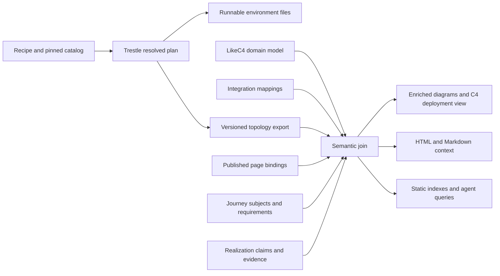

# Converging the lakehouse model and Trestle environments

**Status:** proposed design, 2026-10-15. The recommendations below are not
accepted architecture decisions. This session changes design documents only.
**Execution:** [implementation plan](trestle-model-convergence-plan.md).

The intended result is a documentation environment whose runnable files,
deployment graph, architectural context, and tested examples agree. Trestle
provides the resolved environment; the lakehouse model provides its meaning;
journeys describe work against those concepts, and snippet claims and execution
results provide evidence of behavior. A versioned join connects them, with an
explicit owner for each fact.

## 1. What exists today

These observations come from the current checkouts of docs-factory and the
sibling `trestle` repository. Recheck them when implementation begins.

| Concern | Existing source | Implication |
| --- | --- | --- |
| Domain vocabulary | `architecture/model/specification.likec4`, `logical/{capabilities,assets,technology-catalog}.likec4` | Asset kinds, capabilities, specifications, and implementations already exist. |
| Concrete environments | `architecture/model/deployment/deployments.likec4` | One environment, `trustedCompute`, with five deployment nodes and four capability instances. The JSON export has no deployment relationships. |
| Architecture prose and registry | `architecture/README.md`, `design/deployments.md`, `canonicals.yaml` | Still describe three topologies and governance roles absent from the current model. Some asset prose describes `requires` edges while the source uses `dependsOn`. Reconcile before treating prose as a machine contract. |
| Trestle environment input | `crates/stack-topology/src/manifest.rs` | Version-3 `EnvManifest` holds `Selection` and full `PlanCtx`; planning depends on catalog data too. |
| Trestle composition | `src/catalog/module.rs`, `src/model/role.rs` in that crate | A module is a reusable composition unit. It can contribute several services and helpers. Roles are an open set; `provider_of` is a selection mechanism. |
| Trestle graph | `crates/stack-topology-wasm/src/topology.rs` | A pure projection of the settled `Plan`: functional components, external providers, gateway surfaces, provisioned resources, and typed edges. Helpers are intentionally folded into their module. |
| Diagram exchange | `node/env-editor/src/diagram/snapshot.ts` | Version-1 `trestle-graph` snapshots and a renderer independent of the planner already exist. |
| Browser planner | `crates/stack-topology-wasm/src/{dto,bindings}.rs` | WASM support is implemented. `plan_result` currently takes selection and target, defaulting the rest of the context; its file list excludes sensitive files. |
| Docs environment contract | `envs/environments.yml`, `site/src/content-core/{registry,environment}.mjs`, `tools/docsnip/src/docsnip/environments.py` | Pages and scripts already join to a Compose path, reader commands, ports, and host client variables. |
| Reader distribution | `emit/docs/env-bundle.mjs` | Deterministic archives and `environments.json` already ship. The archive currently selects tracked files by directory. |
| Behavioral evidence | `content/<project>/compatibility.yml`, snippet claims, `docsnip compat` | Journeys and interfaces are already modeled separately from architectural relationships. Ready pages' scripts gate CI. |
| Public architectural context | `emit/docs/model.mjs`, `docs/design/model-leverage.md` | Model links and diagram descriptions ship; a curated public concept projection remains proposed. |

The old `agentic-docs.md` proposal needs updating: it proposes creating WASM
bindings that now exist, assumes capability identifiers align, and predates the
current separation between the review app and emitted reader sites.

The model is already a domain graph expressed in LikeC4. Keep its useful domain
types; C4's deployment notation supplies a view of runtime structure rather than
dictating a hierarchy for every domain concept.

## 2. The concepts to distinguish

| Concept | Question it answers | Example |
| --- | --- | --- |
| Asset kind | What kind of subject is managed? | Table, view, volume, registered model, agent skill |
| Capability | What can the platform do? | Cataloging, query execution, lineage, governance, observability |
| Specification / contract | What interface or semantics are agreed? | UC API, S3 API, Delta protocol, MCP |
| Implementation | What software supplies behavior? | Unity Catalog OSS, MLflow, DataFusion, RustFS |
| Module | What reusable unit can Trestle compose? | An object-store module with its STS shim and initialization job |
| Environment recipe | What configuration do we want? | An `env.toml` with selections, context, and pinned generator/catalog inputs |
| Resolved environment | What will that recipe materialize? | Selected providers, configured endpoints, resources, and routes |
| Journey | What outcome does a reader seek, on which subjects, with which requirements? | Read a table through an Iceberg REST catalog |
| Journey realization / evidence | Which participants perform that journey under which conditions, with what result? | A pinned PyIceberg client reads through a configured UC OSS endpoint in a tested recipe |

This extends the existing vocabulary with explicit joins, rather than replacing
it. A module and an implementation have a many-to-many relationship: a module
can package multiple implementations, and one implementation can appear in
several modules. A functional diagram node is not necessarily one process or one
Compose service.

Capabilities such as governance, lineage, and observability span components.
Treat that as how they are realized, not as a separate, mutually exclusive kind.
An implementation can contribute to several capabilities. Selection by one
primary Trestle role cannot describe all of those contributions.

Keep asset kinds and concrete assets distinct. Tables created by a tutorial can
be identified in its examples and evidence without adding every table instance
to the architectural model. Provisioned buckets and databases are deployment
resources; a UC volume is a governed registration with its own semantics.

For the first taxonomy extension, audit **view** as an explicit asset kind.
Disambiguate "model" into a registered model, an experiment, a serving endpoint,
or another actual subject before adding new kinds. For **MCP**, distinguish the
protocol, a server implementation, a deployed endpoint, its tools, and a
catalog-managed registration. Only the last is necessarily an asset under
management. A skill artifact likewise differs from the service hosting it.

Do not infer implementation support from a specification's asset breadth.
`unityCatalogOSS implements ucSpec` and `ucSpec governs agentSkill` do not prove
that a given OSS release manages skills. Record implementation/release behavior
through scoped evidence; preserve unknown coverage as unknown. Review existing
`governs` descriptions with that qualification before exporting them publicly.

## 3. Ownership and identity

| Fact | Authoritative owner |
| --- | --- |
| Concept definitions, specification relationships, architectural rationale | Lakehouse model in docs-factory `architecture/` |
| Module identities, demands, providers, services, routes, placement, render logic | Trestle catalog and planner |
| A docs recipe's choices, release pins, local image adjustments | Committed docs environment inputs |
| Trestle-to-model interpretation | One docs-factory integration mapping, initially proposed at `architecture/integrations/trestle.yaml` |
| Page ownership, canonical routes, publication eligibility | Docs frontmatter and emitter identity rules |
| Journey identity, subject kinds, and participant requirements | Existing per-project `compatibility.yml` journey definitions |
| Client/journey support | Existing script claims and compatibility evidence |
| Actual execution result | CI run or explicit runtime observation, with its input revision |

Use existing model IDs, such as `unityCatalogOSS` and `lakehouse.catalog`, as
stable references. Qualify exchanged references with a model namespace. Preserve
IDs during this work; introduce aliases for actual renames instead of renaming
all existing elements. Trestle retains its own module and role IDs.

Initially author the cross-repository mappings once in docs-factory, where the
concepts are curated. Publish a portable enrichment artifact that Trestle can
optionally consume. Do not also hand-author those same mappings in Trestle.
If ownership later moves to module authors, make that a migration with one owner.

Mappings must distinguish identity from contribution. Initial candidates:

| Trestle identifier | Model target | Interpretation |
| --- | --- | --- |
| Module `unity-catalog` | `unityCatalogOSS` | Packages this implementation; its relationship to `ucSpec` comes from the model |
| Role `data_catalog` | `lakehouse.catalog` | Functional contribution at the catalog abstraction |
| Role `object_store` | `lakehouse.objectStorage` | Functional contribution; says nothing by itself about S3 versus Azure |
| Role `experiment_tracking` | `lakehouse.modelTracking` | Partial contribution: experiment tracking does not establish the entire model lifecycle |
| Role `tracing` | `lakehouse.observability` | Partial contribution: a trace backend does not establish instrumentation across services |
| Role `policy` | `lakehouse.governance` | Partial contribution; gateway authorization does not establish row/column enforcement |
| Role `relational_db` | No capability target initially | Supporting infrastructure; model its implementation if useful, without inventing a lakehouse capability just to fill a cell |
| Module `omnigent` | `omnigent` | Implementation identity; the current model deliberately gives it no lakehouse capability edge |

These are proposed mappings to validate, not claims of equivalence. Preserve
unmapped roles and implementations in an export, with a coverage report. Only
the selected pilot requires complete mappings for its principal components;
the entire Trestle catalog need not be modeled before anything ships.

## 3a. Journeys connect tasks to the architecture

This is an opportunity to strengthen the join with relatively little authored
metadata. Keep journey definitions in `compatibility.yml` and project their
relationships into the shared context. Do not also hand-author every journey as
a LikeC4 element. Use `(project, journey ID)` as its identity, since the current
IDs are project-scoped and cross-project claims already exist.

Today a `Journey` has only `title`, `summary`, and optional `request`. An
interface can reference a model implementation, but `compat.model_gaps` checks
that implementation against the **matrix-wide** `spec`. This is too coarse:
the UC matrix declares `spec: ucSpec` while containing `iceberg.read` and other
Iceberg REST journeys. Their clients may use Iceberg REST without consuming
the UC API. That is a concrete reason to add journey-specific requirements.

Separate two things:

- **Journey requirements:** subject kinds and participant contracts needed for
  the stated outcome. Usually these describe replaceable roles, not a particular
  product. A capability can be reached through its contract's `specifies` edge.
- **Realization bindings:** the interface, pinned libraries/connectors, deployed
  catalog endpoint, storage configuration, and snippet that attempt the journey.
  Existing claims and script environment metadata already supply much of this.

For example, this is a proposed additive schema, not syntax supported today:

```yaml
journeys:
  iceberg.read:
    title: Read an Iceberg table
    summary: Read an Iceberg table by its catalog name, with credentials the catalog vends.
    subjects: [lakehouse.table]
    requires:
      client:
        consumes: [icebergRestSpec]
      catalog:
        implements: [icebergRestSpec]
```

This small example expresses the catalog protocol requirement, not a complete
credential-vending contract. The existing journey's stronger outcome also
depends on configured credential issuance and a reachable storage provider.
Add those requirements only with accurately defined contracts or scoped
capability requirements; do not equate S3 compatibility with credential vending.

Here `client` and `catalog` are journey participant roles, distinct from
Trestle's provider-role identifiers. An existing PyIceberg claim supplies the
client interface; its script names `unitycatalog/compose.aws.yaml`, which binds
the catalog and storage when the environment mapping is available. The same
journey can have a different realization using another catalog implementation.
An implementation-specific task can legitimately name that implementation, but
the generic catalog-read journey should require the protocol it actually uses.

A provider's abstract `implements` relationship is useful architectural context.
Validation of a concrete realization also needs the selected release/configuration
and an endpoint exposing the required contract through the caller's access path.
Bind exported service/endpoint IDs explicitly where several candidates exist;
never select the first matching catalog by display name. Interface model
bindings can include connector/library composition where needed; an engine name
alone does not establish that its required connector is installed.

Not every actor is an engine and not every journey needs Compose. The existing
CLI, SDK, function, volume, and direct Delta-library examples remain valid.
Local/in-process participants and filesystem resources need no fake server or
object-store deployment node. The first slice adds optional `subjects` and
role-based `requires`, retaining existing IDs, claims, matrices, and row order.
Default each requirement list to conjunction; defer alternatives, planning
expressions, global journey hierarchies, and automatic stack synthesis.

Validate progressively:

| Check | Treatment |
| --- | --- |
| Malformed new fields, wrong referenced element kind, dangling declared participant/endpoint binding | Error |
| Missing semantic annotations on an unmigrated journey | Coverage report |
| A positive claim explicitly binds a known incompatible endpoint/configuration | Metadata inconsistency requiring correction |
| A valid test uses a client whose model node or `consumes` edge is absent | Model coverage gap; preserve the test evidence |
| A claim deliberately asserts failure because a requirement is unmet | Valid negative evidence with that scope; do not reject it as a successful realization |
| All modeled requirements appear satisfied | Structurally plausible; successful execution still supplies behavioral evidence |

Keep each proof's environment and effective inputs in the resolved output.
The current matrix treats opposing ready claims in one cell as an error. Retain
that behavior initially; showing contradictory outcomes for different recipes
requires an explicit scoped view, not silently selecting one proof or declaring
the journey universally unsupported. External documented evidence can remain
partially bound; it must not acquire an invented test environment.

Derive useful links from the existing page/region/claim association:

- A task links to its subject definitions, participant contracts, required setup,
  and tested client alternatives.
- An asset or specification explanation can link back to the approved journeys
  demonstrating it; a journey can highlight its participants in the environment
  graph while retaining the rest as context.
- Agents can find a tested realization for a requested task, or explain which
  requirement is unbound or unverified in a selected stack.

Distinguish derived **demonstrates / operates on / uses** context from authored
`explains` and `references`: a storage dependency does not automatically make the
page an explanation of object storage. Avoid another authored page-level list
of journeys when script claims already establish that association.

Implement the first slice independently of Trestle: annotate `iceberg.read`, one
UC API journey, and a direct Delta read; make diagnostics journey-aware. Add
concrete environment bindings when exports exist. The journey stays the tracked
unit of work, however many calls it involves; this does not reintroduce the
retired atomic-operation inventory.

## 4. Joining the graphs



Export from the same settled `Plan` used to materialize files. Do not reverse
engineer generated YAML to recover facts already present in the planner.
Preserve both functional components and their service membership. The existing
snapshot is a useful diagram exchange format, but it omits the full service
inventory and input provenance needed for a reproducible integration contract.
Its edges currently have typed endpoints rather than explicit IDs; define
stable composite edge keys in the export instead of relying on array positions.

The enriched result should preserve Trestle node and edge identities and add:

- Namespaced concept references and mapping provenance.
- Implementation identity and capability contributions, including partial scope.
- Links to the applicable published explanations and tested journeys.
- Generator/catalog identity, recipe and artifact digests, and the model and
  mapping digests used for enrichment.
- Explicit topology state: **planned configuration**. Runtime health and
  successful execution remain separate evidence with their own provenance.

Keep the ref-free architectural source and versioned execution provenance in
their respective layers. Pins and artifact hashes belong to environment inputs
and export manifests, not to abstract capability descriptions.

Generate a LikeC4 deployment view as another projection of this joined data.
Native `instanceOf` should point to the implementation being instantiated where
one is known; the implementation's `implements`/`realizes` chain supplies
architectural context. Verify that representation in LikeC4 1.58.0 before
migrating the existing deployment model. Helpers stay visible in service-level
detail and can be folded into functional views.

This requires clarifying ADR-0003 alongside ADR-0004: the abstract reference
architecture names no technology, the technology catalog names implementations
(including first-party software), and deployment instances represent their
configured occurrences. The current rule that first-party names appear only in
deployment makes implementation identity hard to join. Retain existing IDs and
views while introducing the clearer distinction.

Keep authored reference/trust scenarios distinct from generated concrete
environments. Matching can show which portions of a scenario are present; it
must not add hypothetical services or relationships to a generated stack.
In particular, gateway forward-auth is different from catalog authorization,
credential scoping, and query-plan row/column enforcement.

The join supports both directions without circular generation: docs consume
Trestle exports, and Trestle's diagram renderer optionally consumes a pinned,
portable context artifact produced by the join. Rendering an unenriched Trestle
graph remains possible offline. Frozen enriched snapshots retain their original
semantic version; showing newer context is an explicit re-enrichment.

## 5. Documentation environment integration

The proposed first pilot is the existing Unity Catalog docs environment,
starting with its S3 credential-vending journey. Its local-file and PostgreSQL
variants are part of the subsequent parity assessment.

There are concrete gaps to resolve before cutover:

- Docs pin UC **0.7.0**; Trestle's current catalog default is **0.6.0**. A docs
  recipe must take the docs release pin explicitly.
- Docs carry a local image for CLI compatibility and Linux bind-mount ownership,
  plus a shared `UC_DOCS_ROOT` path and a fixed container name used by examples.
  An image knob alone does not reproduce that build context and behavior.
- Trestle's UC module always demands a relational store and object store. The
  basic docs environment uses H2 and local files. Optional resources require an
  explicit module configuration or a distinct module with the same software
  identity; assess which makes the catalog clearer.
- Trestle always supplies a gateway. Docs expose UC directly on 8080, and the
  test harness discovers that service's published port. Client addressing must
  consume the generated host contract before port exposure changes.
- Client variable spellings differ: docs currently export `AWS_ENDPOINT_URL`
  and `AWS_ALLOW_HTTP`; Trestle contributes `AWS_ENDPOINT_URL_S3` and `AWS_REGION`.
  Adapt deliberately to the libraries used by docs, rather than silently losing
  required client settings.
- Browser `PlanResultDto.files` omits sensitive files, including UC config
  files that materialization needs. A runnable download must use the complete
  materialization with an explicit public-demo file policy, not that display list.

Generate in a clean staging directory with a pinned Trestle/catalog version;
review and commit the recipe and generated environment payload for now. CI
checks regeneration, and reader-site emission packages those files without a
Trestle checkout or a Rust build. Readers continue to download a bundle and run
Docker Compose. Preserve existing registry keys until an explicit migration.
Pin effective runtime images by digest in the recipe or an environment lock;
record local build inputs and the image digests actually tested. Deterministic
YAML containing a mutable `latest` tag does not reproduce the tested environment.

Keep titles and setup-guide links authored in the environment registry. Derive
mechanical ports and host client settings from the plan, with checked adapters
where docs need client-specific settings. Do not leave the same endpoint value
independently maintained in a recipe, registry, and snippet.

Bundle the exact self-contained payload that CI exercises, including referenced
build contexts, scripts, config files, and locally required demo credentials.
Use an explicit file manifest: the existing directory-wide tracked-file scan
would otherwise publish new recipe/export metadata unintentionally. Test archive
extraction and Compose startup as well as the repository paths.

## 6. Value for readers, agents, and GEO

Prioritize grounded, crawlable explanations and reproducible answers. Neither
custom graph JSON nor `llms.txt` guarantees indexing or citations.

1. **A page explains its actual environment.** Short static text identifies the
   catalog implementation, storage, client access path, and relevant scope.
   HTML and Markdown twins carry equivalent context and links.
2. **Compatibility evidence gains environment context.** A reader can connect a
   tested journey to its server release, client pin, environment configuration,
   and runnable script. An architecture edge alone never becomes a green cell.
   Journey subjects and participant requirements provide the links back to
   concepts and contracts, with approved examples as backlinks.
3. **Diagrams explain their nodes.** Clicking a module exposes concept definitions,
   the exact implementation, documentation, and relevant examples. A static
   caption or component table remains useful without JavaScript.
4. **Agents can answer precise questions.** Start with local queries for
   `environment_for_example`, `explain_environment`, `examples_for_concept`, and
   `explain_selection`. Return evidence and missing coverage. A requested
   capability may map to several modules and prerequisites; do not turn a
   concept label directly into an assertion that the requested outcome works.
5. **Maintenance becomes more targeted.** A change to a module, release pin, or
   specification can identify affected environments, claims, pages, and graphs.
   Graph-backed lint can flag missing evidence for review; it cannot reliably
   decide arbitrary prose truth by string matching.

A public projection is project-specific. Include only deliberately public
concepts and published pages; filter relationships as well as nodes. A ready
page referencing an internal element does not make that element public.
Public docs environment graphs may be published explicitly without exposing the
entire internal deployment estate. Preview/private/draft material and internal
source paths stay out of public artifacts. Reuse the emitted sites' identity and
publication rules, not the login-gated factory app's routes.

Measure mapping coverage, environment reproducibility, broken references,
successful example runs, and agent task accuracy. Evaluate search/citation
changes separately; avoid attributing them automatically to graph enrichment.

## 7. Decisions to settle through the pilot

- **Ownership:** start with one integration map in docs-factory and a portable
  optional context artifact for Trestle. Revisit module-owned references only if
  custom catalogs demonstrate a need.
- **Scope:** reuse the current taxonomy; add view/MCP-related kinds only with
  precise definitions and sourced support claims. Avoid a broad ontology rewrite.
- **Deployment representation:** prototype implementation instances and explicit
  runtime edges, then clarify the architecture ADRs before migrating reference views.
- **Distribution:** initially commit generated environment payloads and snapshots
  with regeneration checks. Published package hosting is a separate delivery task:
  the existing editor/WASM packages are private workspace packages.
- **First environment:** use UC docs as the default pilot. A broader lakehouse
  environment can later test cross-cutting lineage/observability contributions.

## 8. Concrete convention updates proposed

When the pilot lands, add this to `architecture/README.md` and align its
maintenance skill and ADRs:

> Abstract capabilities and asset kinds are technology-neutral. The technology
> catalog identifies specifications and software implementations, including
> first-party software. Deployment instances identify configured occurrences.
> Generated environment wiring comes from a pinned Trestle plan; authored
> reference scenarios remain separately identified. Implementation and
> specification edges express architectural relationships, not release-specific
> proof of operational support.

Add this to `content/README.md` and summarize it in the root contributor notes:

> A generated docs environment commits its recipe, generator/catalog pin,
> complete runnable payload, and export manifest together. Regenerate it as a
> unit. Pages and scripts retain one registered environment key; client addresses
> come from the generated host contract. Compatibility claims stay on tested
> snippets and retain their environment scope. Reader downloads contain only
> explicitly selected files from that tested payload.

Extend the existing "Compatibility claims" convention with:

> Journey definitions own their subject kinds and participant requirements;
> claims bind an interface and script, and the script's environment supplies
> configured participants. Express replaceable participants through their
> required contracts. Keep implementation/version details on the realization
> unless the task specifically requires them. Derived journey links come from
> claims and shown regions. Missing architectural coverage is reported separately
> from observed journey outcomes; no graph path alone establishes support.

The implementation plan makes those updates part of the relevant changes,
instead of silently introducing exceptions to today's conventions.
