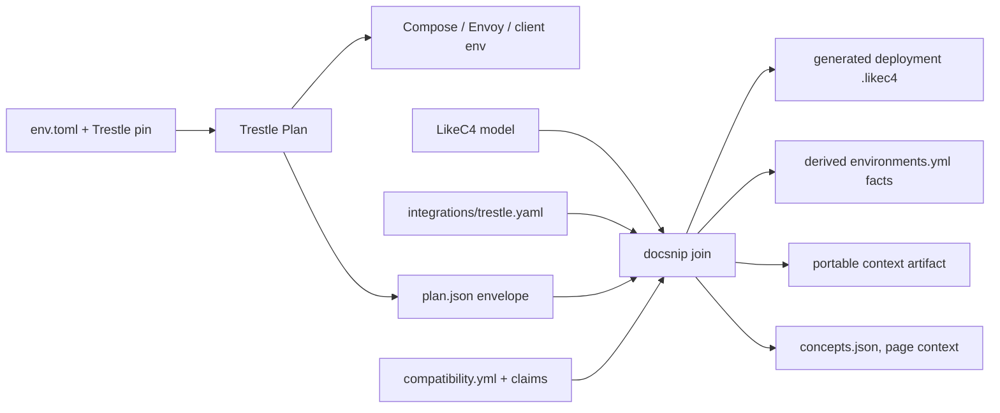

# Converging the estate model with Trestle environments

**Status:** design, 2026-10-15. Proposed; nothing is built.
**Execution:** [phased plan](trestle-model-convergence-plan.md), one session per phase.
**Supersedes:** two independent drafts (#216, #217), consolidated here. §10
records which decisions were settled and which are defaults open to review.

This design covers how the LikeC4 estate model (`architecture/model`), Trestle's
environment generator (`trestle/crates/stack-topology`), the docs environments
(`envs/`), and the tracked journeys (`content/<project>/compatibility.yml`) come
to share one vocabulary. It has three outcomes:

- Trestle generates the docs environments, and each one appears in the model's
  deployment layer.
- Journeys join assets, contracts, and environments, so model edges can carry
  CI evidence.
- The joined graph reaches readers, search engines, and agents as static,
  grounded context.

It builds on [ADR-0001](../decisions/ADR-0001-model-driven-information-system.md),
[`model-leverage.md`](./model-leverage.md) (its SEO and GEO verdicts hold), and
architecture ADRs
[0003](../../architecture/adr/ADR-0003-logical-abstract-deployment-concrete.md)
through [0006](../../architecture/adr/ADR-0006-system-boundary-and-generic-relations.md).

## 1. The problem

Two artifacts describe the same lakehouse, and neither knows the other's IDs.

- **The model** types the estate along asset kinds (ADR-0005) and the
  capability / specification / implementation altitudes (ADR-0004). Its
  deployment layer holds one hand-written environment, `trustedCompute`.
  One `capability` kind covers both the *layers* that materialize assets
  (catalog, query engine, table format, object storage) and the *properties*
  that span them (governance, lineage, observability). These behave differently:
  lineage has no place in `queryEngine → tableFormat → objectStorage`, because
  it applies to tables and models wherever they live.
- **Trestle's `stack-topology`** plans an environment from an `env.toml`
  selection, then renders Compose, Envoy, client env files, and a graph
  (`GraphDto`, projected from the settled `Plan` by `graph_dto`). Its roles
  (`data_catalog`, `object_store`, `tracing`, `policy`, …) resemble our
  capabilities, and its modules (`unity-catalog`, `rustfs`, `postgres`, …)
  resemble our implementations. It has no notion of what a node *is* in estate
  terms, so its graph can't link to a concept, a spec, or a page.
- **The docs environments** (`envs/unitycatalog`, `envs/aws-sim`) are written by
  hand. `envs/environments.yml` repeats facts (ports, client env) that a plan
  computes, and the model knows nothing about them.
- **Journeys** are CI-verified, but their link to the model is thin. Each
  interface names an implementation (`model:`), and one matrix-wide `spec:`
  stands in for every requirement. That is wrong in practice: the UC matrix
  declares `spec: ucSpec` while holding `iceberg.*` journeys whose clients use
  Iceberg REST, not the UC API. The asset a journey acts on exists only in its
  family name.

### Drift to clean up first

- No element has kind `role`, yet `canonicals.yaml` lists
  `lakehouse.governance.{pap,pdp,pep,pip,pa}`, and `architecture/README.md` and
  `design/deployments.md` describe three topologies the model doesn't have.
- `logical/capabilities.likec4` points at a nonexistent `governance.likec4`;
  `explain-views.likec4` mentions a missing `governanceModel` view.
- ADR-0005 and `specification.likec4` comments describe a `requires` relationship
  that was never declared; `assets.likec4` uses `dependsOn`.
- `unityCatalogOSS` has no `implements icebergRestSpec` edge, though UC 0.7
  serves Iceberg REST and H21 proves it in CI. The journey checks in §5 exist to
  catch this kind of gap.
- `agentic-docs.md` proposes creating WASM bindings that now exist and predates
  the review-app / reader-site split.

### What already exists

| Concern | Source | Use |
|---|---|---|
| Trestle input | `crates/stack-topology/src/manifest.rs` | Versioned `EnvManifest` holds `Selection` and the full plan context. |
| Trestle composition | `src/catalog/module.rs`, `src/model/role.rs` | A module can contribute several services and helpers; roles are an open set. |
| Trestle graph | `crates/stack-topology-wasm/src/topology.rs` | Pure projection of `Plan`: components, providers, surfaces, resources, typed edges. Helpers fold into their module. Edges have no IDs. |
| Browser planner | `crates/stack-topology-wasm/src/{dto,bindings}.rs` | `plan_result` takes selection + target and defaults the rest of the context; its file list omits sensitive files. |
| Diagram exchange | `node/env-editor/src/diagram/snapshot.ts` | v1 `trestle-graph` snapshots with a planner-independent renderer. |
| Docs env contract | `envs/environments.yml`, `site/src/content-core/{registry,environment}.mjs`, `tools/docsnip/src/docsnip/environments.py` | Pages and scripts join to a compose path, reader commands, ports, client env. |
| Reader bundle | `emit/docs/env-bundle.mjs` | Deterministic archives from `git ls-files envs/<dir>/`. |
| Behavioral evidence | `compatibility.yml`, script claims, `docsnip compat` | Journeys × interfaces; ready pages' scripts gate CI. |

## 2. Concepts

| Axis | Kind | Members | Realized by |
|---|---|---|---|
| Subject: what the platform manages | `asset` (type-level) | namespace, table, view, metricView, volume, registeredFunction, mlModel, agentSkill, credential, externalLocation | — |
| Function: layers that materialize assets | `capability`, with `openSpecification` contracts | catalog, queryEngine, orchestration, tableFormat, fileFormat, objectStorage, credentialIssuer, modelTracking, sharing | `implementation` (`implements` a spec or `realizes` the capability) |
| Property: spans assets and capabilities | **`concern`** (new) | governance, lineage, observability | `implementation` (`realizes`) |
| Instance | deployment `environment` / `service` / `datastore` | one generated environment per docs env, plus narrative `trustedCompute` | `instanceOf` an implementation |

**Journeys sit across the triad.** A journey is an outcome a reader seeks on an
asset, with participants that must provide or consume certain contracts. An
interface (Spark, PyIceberg, the UC CLI) attempts it inside an environment, and
a gating CI claim makes that attempt a *verified* fact for that scope.

**Trestle's terms map onto this:**

| Trestle | Model |
|---|---|
| module | implementation (many-to-many: a module can package several; one implementation can appear in several modules) |
| role | contribution to a capability or concern, full or partial |
| plan | deployment environment |
| provisioned resource (database, bucket) | `datastore` node; not an asset kind |

Trestle's own word "capability" (`Selection.capabilities`, `provider_of`) means a
role string. Document the difference; rename neither side.

**Evidence is not architecture.** `unityCatalogOSS implements ucSpec` and
`ucSpec governs agentSkill` do not prove that a given OSS release manages
skills. An architecture edge or graph path alone never becomes a green
compatibility cell; release-specific support comes from scoped claims, and
unknown coverage stays unknown.

### The `concern` kind

| Element | Kind after | Why |
|---|---|---|
| `lakehouse.governance` | concern | Applies to every asset kind. Authentication and authorization fold in until an identity spec anchors a separate concern. |
| `lakehouse.lineage` | concern | Tracks assets across engines; not a layer in the read path. |
| `lakehouse.observability` | concern | Observes running capabilities. |
| `lakehouse.sharing` | stays capability | Has a contract (`openSharingSpec`) and is a protocol surface. |
| `lakehouse.credentialIssuer` | stays capability | A step in the vending chain. |

A LikeC4 FQN comes from nesting, not kind, so `lineage = concern "Lineage"`
inside `lakehouse` keeps `lakehouse.lineage`. Every `model:` link, `explains:`,
`references:`, `blogs/tags.yml` element, `canonicals.yaml` entry, and headwaters'
`instanceOf` stays intact; only code that filters *by kind* changes.

The spanning edge is a single kind, `appliesTo` (concern → asset or capability,
dotted), with the verb in the title ("tracks lineage of", "secures",
"observes"). One kind keeps the validators simple.

## 3. Ownership and identity

Each fact type has exactly one owner.

| Fact | Owner |
|---|---|
| Concept definitions, spec relationships, architectural rationale | Model, `architecture/` |
| Module identities, demands, providers, services, routes, render logic | Trestle catalog and planner |
| A module's implementation identity | Trestle module, as an optional `model:` ref (§4) |
| Role → capability/concern contribution, with scope | docs-factory `architecture/integrations/trestle.yaml` |
| A docs recipe's selections, release pins, local image | `envs/<name>/env.toml` and its build context |
| Page ownership, routes, publication eligibility | Frontmatter + emitter identity rules |
| Journey identity, asset, requirements | `compatibility.yml` |
| Client/journey support | Script claims |
| Execution result | The CI run, against a recorded input revision |

Use existing model IDs (`unityCatalogOSS`, `lakehouse.catalog`) as the stable
references. Preserve IDs during this work; introduce aliases only for real
renames. Trestle keeps its own module and role IDs.

**Why split module refs from role mappings.** A module's implementation is a
1:1, rarely changing identity fact that should travel with the module, including
in custom catalogs, so Trestle's own graph can say what a node *is*. A role's
contribution is an interpretation ("`tracing` is a *partial* contribution to
observability") that belongs with the concepts it interprets. Putting it in
Trestle would make Trestle carry our semantics; putting module identity in
docs-factory would leave custom-catalog modules unmapped. The docs-factory
side publishes a portable context artifact that Trestle can optionally consume
for diagram enrichment (§8); Trestle never hand-maintains a second mapping.

## 4. Mappings

### Module → implementation (on the Trestle module)

`unityCatalogOSS`, `mlflow`, and `omnigent` exist today; P1 adds the rest to
`logical/technology-catalog.likec4`.

| Module | `model:` | Edges to add |
|---|---|---|
| `unity-catalog` | `unityCatalogOSS` | `implements icebergRestSpec` |
| `mlflow` | `mlflow` | |
| `omnigent` | `omnigent` | |
| `headwaters` | `headwaters` (new) | `realizes lineage` |
| `envoy` | `envoy` (`#infra`) | |
| `authelia` | `authelia` | `realizes governance` |
| `opa` | `openPolicyAgent` | `realizes governance` |
| `postgres`, `hosted-postgres` | `postgresql` (`#infra`) | |
| `rustfs` | `rustfs` (`#infra`) | `implements s3Api` |
| `aws-s3` | `amazonS3` (`#infra`) | `implements s3Api` |
| `azurite` | `azurite` (`#infra`) | `implements azureBlobApi` |
| `hosted-azure-storage` | `azureBlobStorage` (`#infra`) | `implements azureBlobApi` |
| `jaeger` | `jaeger` | `realizes observability`, `consumes otlpSpec` |
| `marimo` | `marimo` | |
| `puppygraph` | `puppygraph` | `realizes queryEngine` |

New specs: `azureBlobApi`; optionally `openLineageSpec` and `otlpSpec`.

`headwaters` becomes an implementation because a module ref always names an
implementation. That requires amending architecture ADR-0003: the abstract
reference architecture names no technology, the technology catalog names
implementations *including first-party software* (`omnigent` is already there),
and deployment instances are their configured occurrences.

### Role → contribution (in `architecture/integrations/trestle.yaml`)

| Role | Target | Scope | Note |
|---|---|---|---|
| `object_store` | `lakehouse.objectStorage` | full | Says nothing by itself about S3 vs Azure. |
| `data_catalog` | `lakehouse.catalog` | full | |
| `sql_engine`, `graph` | `lakehouse.queryEngine` | full | PuppyGraph queries Delta tables. |
| `experiment_tracking` | `lakehouse.modelTracking` | partial | Tracking isn't the whole model lifecycle. |
| `lineage` | `lakehouse.lineage` | full | concern |
| `tracing` | `lakehouse.observability` | partial | A trace backend doesn't instrument every service. |
| `auth`, `policy` | `lakehouse.governance` | partial | Gateway authorization isn't row/column enforcement. |
| `gateway`, `relational_db`, `app_runtime`, `notebooks`, `agent_platform` | — | — | Explicitly unmapped infrastructure. Don't invent a capability to fill the cell. |

These are mappings to validate, not equivalence claims. Unmapped roles and
modules survive every export and show in a coverage report. Only the pilot's
principal components need complete mappings before anything ships.

### New asset kinds

Add only kinds that a tracked journey acts on. Instances stay out, per ADR-0005.

| ID | `dependsOn` | Governed by | Evidence |
|---|---|---|---|
| `view` | table, queryEngine | `ucSpec` | metric views build on views |
| `metricView` | view, queryEngine | `ucSpec` | `metricview.*` journeys; T08, H07 |
| `credential` | credentialIssuer | `ucSpec` | `credential(s).*` journeys |
| `externalLocation` | objectStorage, credential | `ucSpec` | `location.*` journeys |

Deferred: `share` and `connection` until a journey acts on them; MCP until UC
ships a securable for it. When MCP arrives, distinguish the protocol, a server
implementation, a deployed endpoint, and the catalog registration; only the
last is an asset. `agent` is not an asset kind: agents are `person`s and
Omnigent is an implementation.

## 5. Journeys join the model

Journeys stay in `compatibility.yml` and are not LikeC4 elements. This keeps
#193's journeys-only decision (no sub-steps, no atomic-operation inventory).
Identity stays `(project, journey ID)`.

### Schema (additive)

```yaml
spec: ucSpec                  # stays: topic context + fallback for unmigrated journeys
families:
  iceberg:
    asset: lakehouse.table
    requires:
      client:  { consumes:   [icebergRestSpec] }
      catalog: { implements: [icebergRestSpec] }
  metricview:
    asset: lakehouse.metricView
journeys:
  iceberg.read:
    title: Read an Iceberg table
    summary: Read an Iceberg table by its catalog name, with credentials the catalog vends.
    # inherits the iceberg family; any field may be overridden here
```

- A journey inherits its family's `asset` and `requires`, and can override
  either. A family is not always one asset (UC's `external`, `managed`, and
  `iceberg` are all tables that differ by management mode and access path),
  so fields resolve per journey and the family only supplies defaults.
- `asset` is one element ID of kind `asset`. Family defaults for UC:
  `table`/`external`/`managed`/`iceberg` → `lakehouse.table`, `metricview` →
  `lakehouse.metricView`, `catalog`/`schema` → `lakehouse.namespace`, `volume` →
  `lakehouse.volume`, `location` → `lakehouse.externalLocation`,
  `credential(s)` → `lakehouse.credential`. Delta sets one project default,
  `lakehouse.table`.
- `requires` is keyed by **participant role** (`client`, `catalog`, `storage`,
  …). These are journey roles, distinct from Trestle role IDs. A client entry
  lists `consumes`; a provider entry lists `implements` (or `realizes` for a
  capability or concern). Lists are conjunctions. Keying by participant makes
  the client-side and server-side checks explicit instead of inferring the side
  from the element kind.
- Follow ADR-0004: name the spec when one exists, otherwise the capability;
  name an implementation only for an implementation-specific task. Interface
  constraints (Spark 4.2 for metric views) stay on the interface `pin`. Delta
  table features stay journey-level detail.
- Don't equate S3 compatibility with credential vending. Add credential-issuer
  requirements only with a defined contract or scoped capability.

Defer alternatives (disjunctions), constraint expressions, a global journey
hierarchy, and automatic stack synthesis.

### Checks

Malformed references fail; gaps are reported (ADR-0001).

| Check | Treatment |
|---|---|
| `asset`/`requires` doesn't resolve, wrong element kind, malformed fields | **fail** |
| Unmigrated journey (no asset/requires after family resolution) | coverage report |
| **Edge verification:** an interface with a ✓ claim on a journey whose `client` consumes S lacks a `consumes S` edge | **report** (model coverage gap; the test evidence stands). This generalizes today's matrix-spec report, which found Spark/DuckDB/Polars `consumes ucSpec`. Never union the matrix `spec` into explicit requirements. |
| **Environment fit** (after P5): a claiming script's environment has no implementation that provides a provider requirement | **fail**, e.g. an Iceberg claim against a catalog without Iceberg REST |
| Environment fit is ambiguous (several candidates) | **report**; resolve with an explicit `binding:` on the claim |
| A claim deliberately asserts failure because a requirement is unmet | valid negative evidence for that scope |
| Local/in-process participants (direct Delta library, CLI, SDK) | valid with no environment and no fake server |
| Opposing ready claims in one cell | stays an **error**; scoped per-recipe views are deferred |
| `governs` edge from the project spec to an asset with no verified journey | coverage report that feeds content requests (`model-leverage.md` §3.5) |

Python's resolver in `compat.py` is authoritative. JS consumes the projection in
`compatibility.json` and never re-resolves requirements.

### Linking content

The existing compat renderer does all of this; there is no new renderer.

- **Asset rollups.** `<!-- compat:asset:<id> -->` selects every journey on an
  asset ("What you can do with a table, by engine") on the page that
  `explains:` the asset. `compat --fix` renders them; `check` flags stale ones.
- **Row headers link concepts** through `model:` links to the asset and
  required specs, resolved by the #189 emit resolver.
- **Page semantics come from claims.** A page's proven journeys supply its
  JSON-LD `about` (assets) and `mentions` (specs, interfaces). Hand-written
  `references:` covers only what claims don't. Derived "demonstrates / uses"
  context is distinct from authored `explains`: a storage dependency doesn't
  make a page an explanation of object storage.
- **Evidence flows back.** `compatibility.json` records which model edges have
  CI evidence, so `concepts.json` (§8) can mark them `verified`.
- **Review app.** Plan → Compatibility can group by asset.

## 6. Joining the graphs



### `plan.json` is the export contract

`trestle env render` writes `plan.json` from the same settled `Plan` that
materializes the files. It is the `PlanResultDto` without file bodies, wrapped
in a versioned envelope with a JSON schema and fixtures:

- functional graph nodes with their `model:` ref, plus the service inventory
  and each service's component membership (helpers stay visible here even
  though functional views fold them);
- typed edges with **stable composite keys** (`kind:from→to[:qualifier]`),
  because the current DTO has none;
- surfaces (listeners, routes, published ports) and the host/container client
  contracts;
- provenance: schema version, Trestle revision, catalog identity, and a
  canonical digest of the normalized recipe (no timestamps, no machine paths);
- state: **planned configuration**. Health and execution are separate evidence.

Native CLI and WASM share one pure projection (a `stack-topology::projection`
module, re-exported by the WASM crate), so there's no second `graph_dto`.
`plan_result` gains a variant that honors the full `EnvManifest` context; the
defaulting call stays for compatibility. Graph exports carry no resolved
credentials. Don't reverse-engineer generated YAML for facts the planner has.

Image-digest locks are deferred: the docs Dockerfile's `FROM` is pinned to the
release tag, and `release.yml` already moves it.

### The join runs in docsnip

`docsnip envs --fix` (Python, following the `compat --fix` / `check` pattern)
reads committed `plan.json`, `architecture/dist/model.json`, and the role map,
and needs no cargo. It writes:

1. **`architecture/model/deployment/generated/<env>.likec4`** (LikeC4 loads
   everything under `model/`). IDs are environment-qualified with deterministic
   escaping. Nodes become `datastore` when their role is `relational_db` or
   `object_store`, and `service` otherwise; each is `instanceOf` its
   implementation. The fragment carries a `#generated` tag, which the estate
   views (`referenceContext`, `capabilityMap`) exclude, so generated
   environments don't crowd the default diagram.

   | `TopologyEdgeDto` | LikeC4 |
   |---|---|
   | `uses` toward a spec-bearing capability (S3) | `consumes` |
   | `uses` otherwise | `dependsOn` |
   | `route` | `flows`, titled with listener and prefix |
   | `authenticates` / `authorizes` | `dependsOn`, titled "authenticates via" / "authorizes via" |
   | `access` | dropped (clients are implicit) |

   ```
   deployment {
     environment docsUcAws {
       gateway = service "envoy" { instanceOf envoy }
       unitycatalog = service "unitycatalog" { instanceOf unityCatalogOSS }
       rustfs = datastore "rustfs" { instanceOf rustfs }
       gateway -[flows]-> unitycatalog ":8080 /api/2.1/unity-catalog"
       unitycatalog -[consumes]-> rustfs "S3"
     }
   }
   ```

   Every projected edge traces to a `plan.json` edge key. Never copy logical
   blueprint edges into an environment as runtime calls, and never infer trust
   or fine-grained enforcement from placement: gateway forward-auth is not
   catalog authorization, credential scoping, or row/column enforcement.
2. **Derived `environments.yml` facts**: ports from surfaces' `host_port`, and
   `client-env` from the host client env. `title` and `guide` stay authored;
   `environments.py` merges the two through a `generated: <name>` key. No
   endpoint value is maintained independently in a recipe, registry, and snippet.
3. **The portable context artifact** for Trestle's diagram (§8): per module and
   role, the concept refs, titles, summaries, public links, and maturity.

`trustedCompute` stays hand-written as the narrative reference topology.
Matching may show which parts of a reference scenario a generated environment
contains; it never adds hypothetical services to a generated one.

## 7. Docs environment integration

The pilot is the UC S3 credential-vending environment (`compose.aws.yaml`,
11 scripts), generated beside the hand-written one as `envs/uc-aws/`. Cutover
then goes postgres (1 script), then the default H2 environment (about 20
scripts). Counts are from 2026-10-15; recount at the start of each phase.

| Gap | Resolution |
|---|---|
| Docs pin UC 0.7.0; Trestle's catalog defaults to 0.6.0 | The recipe takes the release pin explicitly; `bump-uc` rewrites it. |
| Docs run a local image (`envs/unitycatalog/image/Dockerfile`: `gcompat` for the x86 CLI's snappy, the `run-as-owner` entrypoint for Linux bind-mount ownership, a `bin/uc` wrapper) | New UC module **`build` knob**. The Dockerfile stays beside the recipe and ships in the bundle. |
| Examples `docker exec unitycatalog bin/uc` (8 files) | `container_name` knob. |
| The shared `UC_DOCS_ROOT` bind | `extra_mounts` knob. |
| The UC module always demands a relational store and object store; the default env is H2 + `file://` | `embedded_metadata` knob drops both demands. |
| Trestle always fronts services with a gateway; docs hit UC on :8080 and S3 on :9000 | `gateway_host_port = 8080`, a dedicated :9000 listener, UC routed at `/api/2.1/unity-catalog` with `Rewrite::Inherit`. Reader URLs stay valid. `content/conftest.py` stops hard-coding `get_service_host_and_port("unitycatalog", 8080)` and reads the host contract from `plan.json`. |
| Client env spellings: docs export `AWS_ENDPOINT_URL`, `AWS_ALLOW_HTTP`; Trestle emits `AWS_ENDPOINT_URL_S3`, `AWS_REGION` | Trestle adds the docs aliases on `unity-catalog`/`rustfs` client env, so prose stays unchanged. |
| Browser `PlanResultDto.files` omits sensitive files that UC needs (`server.properties`, `hibernate.properties`, `.env`) | `[context] local_secrets = "inline"` writes them as plain files and drops them from the generated `.gitignore`. It is the public-demo materialization policy: throwaway local keys only, and it refuses hosted modules. |
| aws-sim parity: RustFS root keys, `RUSTFS_SERVER_DOMAINS` (host JVM virtual-hosted requests need `localhost:9000`), cert paths | Diff `envs/aws-sim/compose.yaml` against Trestle's `templates/modules/rustfs/compose.yaml.jinja` before cutover. Spark's host-side virtual-hosted access is the likeliest break; the sts-shim is already identical. |

**Committed renders.** Each environment commits `env.toml`, the build context,
the rendered Compose / Envoy / client env, and `plan.json`. The bare Vercel
build and the reader bundle have no cargo, so they consume committed files.
`envs/trestle.toml` pins the Trestle revision. A path-filtered (and nightly)
`envs-render` CI job re-renders with that pin and fails on `git diff`.
`docsnip check` reads committed files only. Generate from clean pinned inputs so
stray operator files can't leak into the result.

**Bundle exactly what CI runs.** Generated environments replace the
directory-wide `git ls-files` scan in `emit/docs/env-bundle.mjs` with an
explicit runtime-file manifest: transitive Compose inputs, the build context,
config files, scripts, and modes. Recipe and graph metadata ship only when
selected. An archive smoke test extracts the emitted bundle outside the repo,
starts Compose there, and runs a pilot script against it.

**Not every journey needs Compose.** CLI, SDK, function, volume, and direct
Delta-library examples stay valid without a stack. Delta's Spark lane and the
`kind` lane (H22, H24) stay outside Trestle for now (§11).

## 8. Readers, agents, and GEO

The `model-leverage.md` §2 verdicts hold: no generated page per element, and
raw `model.json` stays internal. Grounded, crawlable explanations and
reproducible answers come first; neither custom graph JSON nor `llms.txt`
guarantees indexing or citations.

- **"What's in this environment."** `:::prerequisites`
  (`site/src/content-core/environment.mjs`, `emit/docs`) gains a short list of
  the environment's services that map to page-worthy elements: a `model:` link,
  a one-line role, and its URL. Static HTML; the `.md` twin carries it.
- **JSON-LD** through `docPageHead` (`site/src/content-core/head.mjs`, #213/#215):
  `about` takes concerns/capabilities from `explains:`/`references:` plus assets
  from proven journeys; `mentions` takes resolved `model:` links. How-tos and
  tutorials get `tool` (the environment's implementations as
  `SoftwareApplication`, `sameAs` the element's link) and `requirements` (the
  environment title and bundle link).
- **`concepts.json`** (`emit/docs/discovery.mjs`): logical and technology-catalog
  elements including concerns, with typed edges; `environments[]` as a public
  projection; verified journeys (interface × journey × asset, each linked to
  its proving page); model edges with CI evidence marked `verified`.
- **Diagrams explain their nodes.** Trestle's diagram accepts an `annotations`
  prop (title, summary, href, maturity, keyed by module or role) fed by the
  context artifact. Unenriched rendering keeps working offline, and a frozen
  snapshot keeps the semantics it was saved with; showing newer context is an
  explicit re-enrichment.

**Visibility.** A public projection is per site and uses a positive selection:
only deliberately public concepts and published (`ready`) pages. Filter
relationships, backlinks, and generated descriptions along with nodes. A ready
page referencing an internal element doesn't make that element public. Docs
environment graphs can be published on their own without exposing the internal
estate. Draft/private material and repo paths never reach public artifacts.
Use the emitted sites' identity rules, never the factory app's routes.

**Agent queries**, internal first, over the same artifacts:
`explain(id)`, `environment_for(example | journey)`, `examples_for(concept)`,
`explain_selection(env)`. Answers carry stable IDs and an evidence state of
*configured*, *tested in this revision*, *documented*, or *unknown*. A partial
contribution never satisfies a broader request ("full governance")
automatically. **Impact reports** list the environments, claims, pages, and
diagrams affected by a changed module, concept, or release pin, and route
findings through the existing review workflow. A public MCP and a
`generate_stack(capabilities[])` tool are deferred until the local queries
prove accurate.

**Measure** mapping coverage, environment reproducibility, broken references,
successful example runs, and agent task accuracy. Evaluate search/citation
changes separately, without attributing them to graph enrichment.

## 9. ADRs

- **`architecture/adr/ADR-0007-cross-cutting-concerns.md`** (lakehouse fact):
  the concern kind, `appliesTo`, the triad, ID stability across kind changes,
  and the `requires` → `dependsOn` correction. Options considered: a tag on
  capability, a nested group, a separate kind (chosen).
- **Amend `architecture/adr/ADR-0003`**: the technology catalog names
  implementations including first-party software; deployment instances are
  their configured occurrences; generated fragments are `instanceOf`
  implementations.
- **`docs/decisions/ADR-0003-trestle-generated-environments.md`** (factory):
  hybrid ownership (module identity in Trestle, role contributions here),
  generated and committed environments with a pinned Trestle, `plan.json` as
  the contract, and the split between generated environments and narrative
  `trustedCompute`.

## 10. Decisions log

*Settled* = decided by the maintainer during consolidation. *Default* = chosen
while consolidating; revisit in review.

| # | Decision | Status | Rejected alternative |
|---|---|---|---|
| 1 | Hybrid ownership: module `model:` identity in Trestle; role contributions with scope in `architecture/integrations/trestle.yaml` | settled | All in docs-factory (custom catalogs unmapped); all in Trestle (loses partial scope, Trestle carries our semantics) |
| 2 | New `concern` kind + `appliesTo` | settled | Keep `capability`; a `#crossCutting` tag |
| 3 | Journeys: `families:` defaults, singular `asset`, participant-keyed `requires`; prove on 3, then migrate all | settled | Flat `requires` list; per-journey annotation without families |
| 4 | UC docs image via a Trestle `build` knob | settled | Publish an image; bake the fixes into Trestle's UC module; a Compose overlay |
| 5 | `plan.json` (`PlanResultDto` minus bodies) is the versioned export envelope, with service membership, edge keys, provenance | default | A separate new export format |
| 6 | Join, fragment generation, and checks in Python docsnip; JS consumes emitted JSON | default | A JS `content-core/topology.mjs` join |
| 7 | Generated fragments under `model/deployment/generated/`, tagged `#generated`, excluded from estate views | default | A separate composite model |
| 8 | `headwaters` becomes an implementation; amend arch ADR-0003 | default | Module → concern ref |
| 9 | Only journey-backed asset kinds (view, metricView, credential, externalLocation) | default | Also share, connection |
| 10 | Environment fit fails on mismatch and reports ambiguity; `binding:` only when ambiguous | default | Report only; mandatory bindings |
| 11 | Gateway keeps :8080/:9000 URLs; harness reads the host contract | default | Rewrite prose to gateway URLs |
| 12 | `local_secrets = "inline"` as the public-demo policy | default | Filtered browser file list |
| 13 | Explicit bundle manifest + archive smoke test | default | Keep `git ls-files` |
| 14 | Trestle rev + recipe digest; image-digest locks deferred | default | Digest-lock every image now |
| 15 | Contradictory proofs across recipes stay an error | default | Scoped per-recipe views now |
| 16 | `generate_stack` and public MCP deferred | default | Ship with P7 |

## 11. Risks and open questions

**Risks**

- **Kind change.** Any `model.json` consumer filtering `kind == capability` loses
  governance, lineage, and observability until updated. P1 greps for them.
- **Reader URLs.** Bare `localhost:8080` mentions hit Envoy, which answers 404
  at `/` unless a route exists.
- **aws-sim parity** (§7). The likeliest cutover break.
- **Committed secrets.** Throwaway local keys only; inline mode refuses hosted modules.
- **CI cost.** A cold `cargo install` of Trestle takes about 3–5 minutes; only
  the path-filtered `envs-render` job pays it.
- **Two deployment stories.** Generated environments are facts about docs
  environments; `trustedCompute` is narrative. The factory ADR keeps them apart.

**Open questions**

- A `/` catch-all route on the gateway, or fix the prose?
- Does identity split out of governance as its own concern once an OIDC or
  identity spec is modeled?
- Should `appliesTo` titles come from a controlled verb list that validators enforce?
- Should Delta's Spark lane and the `kind` lane become Trestle environments?
- When two recipes legitimately disagree on a journey, what does the scoped view look like?

## 12. Convention text to land

With P6, add to `architecture/README.md` and align the update-architecture skill:

> Capabilities, concerns, and asset kinds are technology-neutral. The technology
> catalog identifies specifications and software implementations, including
> first-party software. Deployment instances are configured occurrences.
> Generated environment wiring comes from a pinned Trestle plan; authored
> reference scenarios stay separately identified. Implementation and
> specification edges are architectural relationships, not release-specific
> proof of support.

Add to `content/README.md`, summarized in `AGENTS.md`:

> A generated docs environment commits its recipe, Trestle pin, build context,
> runnable render, and `plan.json` together; regenerate it as a unit. Pages and
> scripts keep one registered environment key; client addresses come from the
> generated host contract. Reader bundles contain only files from the explicit
> manifest of what CI runs.

Extend "Compatibility claims" in `content/README.md` (with P2):

> A journey's family supplies its asset and participant requirements; the
> journey may override them. Claims bind an interface and a script; the
> script's environment supplies the configured participants. Express
> replaceable participants through the contracts they require, and keep
> implementation and version detail on the interface pin. Missing model edges
> are reported separately from observed outcomes; no graph path alone
> establishes support.
