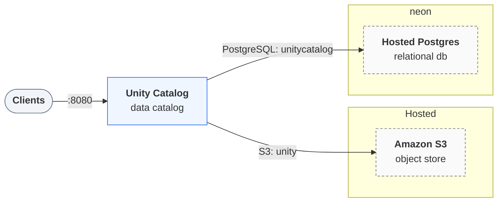

# Deploying `uc-hybrid`

Generated by `trestle env render`; re-render to update. Follow the steps in order. A step's script
runs from anywhere and is safe to re-run. The services, their routes and addresses are in
[LAYOUT.md](LAYOUT.md).

## Architecture



## Provision

### 1. Create the buckets (`aws-s3`)

Create the buckets the stack uses: `unity`, through the S3-compatible API at `${AWS_ENDPOINT_URL}`.
The script needs the AWS CLI, signed in with credentials that may create buckets (a profile,
SSO, or keys). Set `AWS_ACCESS_KEY_ID` and `AWS_SECRET_ACCESS_KEY` to a
key that may read and write them.

```bash
bash deploy/aws-s3-buckets.sh
```

### 2. Create the Neon project (`hosted-postgres`)

Create a Neon project for the stack's databases. The script needs
[`neonctl`](https://neon.tech/docs/reference/neon-cli), signed in (`neonctl auth`, or
`NEON_API_KEY` set), and `jq`. It creates the project `trestle-uc-hybrid` unless it exists
(in `NEON_REGION`, default `aws-us-east-2`), then saves its id as `NEON_PROJECT_ID` and its connection details as `PGHOST`, `PGUSER`, `PGPASSWORD` in `secrets.env`.

```bash
bash deploy/hosted-postgres-server.sh
```

### 3. Create the databases (`hosted-postgres`)

Create the databases the stack uses: `unitycatalog`. The script adds each one missing to the Neon project
`NEON_PROJECT_ID` with `neonctl`.

```bash
bash deploy/hosted-postgres-databases.sh
```

## Configure

### 4. Supply the hosted resources' secrets

The hosted resources read `AWS_ACCESS_KEY_ID`, `AWS_ENDPOINT_URL`, `AWS_SECRET_ACCESS_KEY`, `PGHOST`, `PGPASSWORD`, `PGUSER`. Set them in `secrets.env` beside `env.toml` (git-ignored; the scripts above save what they create there) or export them, then render again so the stack picks them up:

```bash
trestle env render .
```

## Start

### 5. Start the stack

Start every service and wait until each one is healthy:

```bash
docker compose up -d --wait
```

Each service is then published on its own host port. [LAYOUT.md](LAYOUT.md) lists every route and address.
